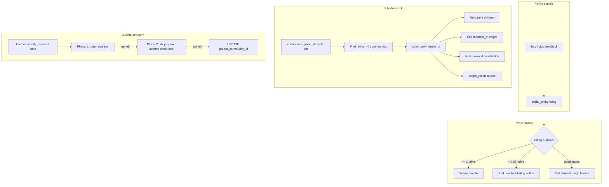
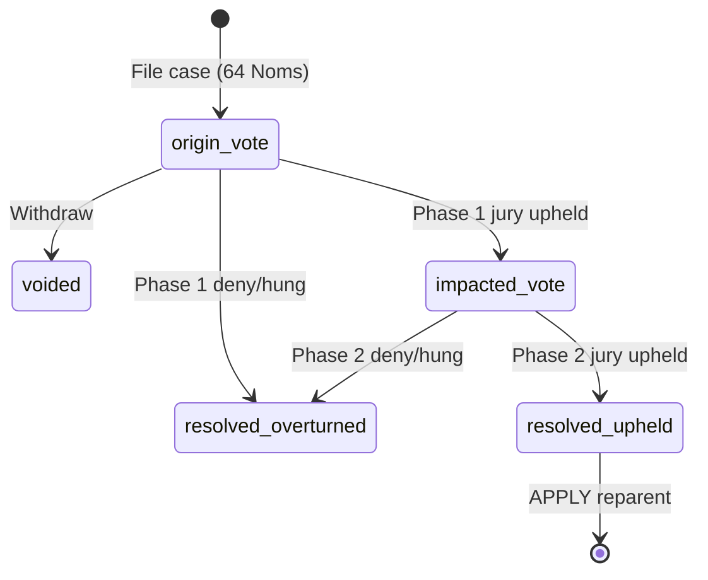

# Community graph management & pruning — implementation plan

Review document for the **judicial consequences / graph lifecycle** module. This connects community `social_entity.rating`, the parent tree (`social_community.parent_community_id`), constitution inheritance, and the existing in-process job scheduler.

**Implementation status (2026-05-24):** Phases A–C are **largely implemented** in code (rating defaults, handle presentation, death batches, human death, judicial re-parent filing/UI/backend). Remaining gaps: full E2E test `tests/community_reparent_judicial.rs` (pool math test exists), doc polish. See [`LAUNCH_READINESS.md`](LAUNCH_READINESS.md) for launch blockers; [`EVOLUTIONARY_BIOLOGY_REVIEW.md`](EVOLUTIONARY_BIOLOGY_REVIEW.md) for ecological reading of death/pruning/immunity; [`POLITICAL_SCIENCE_REVIEW.md`](POLITICAL_SCIENCE_REVIEW.md) for keystone sovereignty.

**Out of scope for v1 (called out explicitly):** post-level `anathema` enforcement beyond rating changes already applied by jury settlement; deliberation/chat on reparent cases (reuse future post conversation work).

---

## Product summary

| Signal | Meaning | System behavior |
|--------|---------|-----------------|
| **Rating ≥ 0.66** | Healthy (or recovering) | Community `@handle` in **sun-burst yellow** (`--c-yellow`) everywhere handles are shown |
| **Rating &lt; 0.66** | **Failing** | `@handle` in **arterial red** (`--c-red`); profile card shows a **failing** notice |
| **Rating = 0.0** | **Dead** (terminal) | Community **dies**: members removed, owned constitution retired, children **re-parented** to dead node’s parent; handles on historical posts show **red + strike-through** |
| **Judicial reparent** | Voluntary graph move | New `judicial_case_trigger` with **two-phase** human jury: (1) √n in the **moving** community; (2) √N over the **union** of all verified members across the moving community **and its entire descendant subtree** |

**Default rating change:** new communities (and backfill policy below) start at **2.50** on `social_entity.rating`, aligned with human default and neutral jury weight semantics.

**Human global spillover from community edges:** when a human's `member_of` relationship rating changes (jury civic feedback, conversation settlement, etc.), the global `social_entity.rating` moves **symmetrically** — **±delta/6** (`judicial::community_member_delta_to_global_spillover`; basal **δ = 0.035**).

**Post inactivity pruning (communities):** **removed** (2026-05-24). Communities no longer lose rating from post idle. `last_post_activity_at` is still maintained for touch/analytics paths.

**Human login-idle pruning:** verified humans with **21+** days without sign-in receive a warning email (no rating change); from **28+** idle days, daily global decrements apply in phases — **21** days at **−1×δ**, **21** days at **−3×δ**, then **−6×δ**/day (`users.inactivity_penalties_applied`, `inactivity_rating_debited`). **`record_user_login`** refunds debited standing and resets the cycle. Rating **&lt; 0.66** shows failing UI — **humans:** red `@handle` and profile warning **for the owner only** (feed/profiles/invitations to others show healthy handle); **communities:** public red handle + profile notice. **0.0** triggers death batch. First sub-0.66 crossing emails use `rating_failing_notified_at` markers.

**Jury pools (do not confuse triggers):**

| Trigger | Pool for sizing & nomination | Cap |
|---------|------------------------------|-----|
| **Constitutional amendment** | Verified `member_of` the **amending community only** (edge rating tiers >2.50 / ≥2.50) | Uncapped √n |
| **Community re-parent phase 1** | Verified `member_of` the **moving community M only** | √n, cap 12 |
| **Community re-parent phase 2** | **Distinct humans** with verified `member_of` to **any** community in **M ∪ descendant subtree** | Uncapped √N |

Constitutional changes do **not** use the descendant subtree union; only re-parent **phase 2** does.

**Public discovery:** dead entities and their posts are excluded from `/public/*`, `/api/public/*`, and entity search (`sql_alive_entity_predicate`).

---

## Current codebase anchors

| Area | Today |
|------|--------|
| Parent tree | `social_community.parent_community_id` (single parent, `ON DELETE SET NULL`) |
| Constitution inheritance | `fetch_effective_constitution` walks ancestors; **owned** clauses on `community_constitution_item` |
| Community rating on create | **2.50** default in `entity.rs` for communities (migration backfill applied) |
| Judicial re-parent | **Live** — `community_reparent` trigger, 64 Noms, two-phase jury — `src/social/judicial/community_reparent.rs`, `templates/judicial_community_reparent.html` |
| Handle color / failing / dead | Community handle tones via lifecycle helpers + CSS in `brand.css`; **human** failing red owner-only via `effective_handle_tone` + `reveal_failing_standing` in `src/ui/entity_handle.rs` |
| Recurring jobs | `src/jobs/scheduler.rs` → `judicial_jury_nomination`, `scope_recalc_drain`, `community_graph_lifecycle`, etc. |
| Judicial triggers (live) | `emergency_safety`, `civic_dispute`, `membership_review`, `constitutional_amendment`, `community_profile_amendment`, `community_reparent`, `moderation_appeal` (`post_moderation` legacy only) |

---

## Architecture overview



---

## Phase A — Rating default & handle presentation (UI + migration)

### A1. Default community rating 2.50

**Migration** `YYYYMMDDHHMMSS_community_rating_default_neutral.sql`:

- Change column default on `social_entity.rating` is **shared across types** — do **not** change the column default globally.
- Instead:
  - **Backfill** all communities at `0.00` → `2.50` (including council/product communities unless a row is intentionally above zero already — do not lower non-zero ratings).
  - **Application:** in `src/social/entity.rs`, set `rating = 2.50` when `type_id == community_type_id` (mirror human branch).

**AGENTS.md** — one line under judiciary or new “Community lifecycle” section.

### A2. Central presentation helper

New module: `src/ui/community_handle.rs` (or `src/social/community_lifecycle.rs` + thin UI wrapper).

```rust
pub enum CommunityHandleTone {
    Healthy,   // >= 0.66, alive  -> yellow
    Failing,   // < 0.66, alive   -> red
    Dead,      // entity_status dead -> red + strike-through
}

pub fn community_handle_tone(rating: Decimal, entity_status_key: &str) -> CommunityHandleTone;
pub fn community_handle_css_classes(tone: CommunityHandleTone) -> &'static str;
```

**Rules (product):**

- Only applies when `entity_type == community`.
- Non-community handles keep current styling (yellow for primary post handles, etc.).
- **Threshold:** `rating < 0.66` → failing (strictly less than 0.66); `rating >= 0.66` → healthy yellow. Constant: `judicial::failing_rating_threshold()`.
- **Death:** `rating == 0.00` → dead presentation (strike-through) once status is `dead`; job sets status when rating hits zero.
- **Dead overrides failing:** once `social_entity_status.dead`, always strike-through styling regardless of numeric rating snapshot.

### A3. CSS (`static/css/brand.css`)

```css
/* Community handles only — applied in addition to base handle weight */
.public-post-handle-line--community-healthy { color: var(--c-yellow); }
.public-post-handle-line--community-failing { color: var(--c-red); }
.public-post-handle-line--community-dead {
  color: var(--c-red);
  text-decoration: line-through;
}
```

Palette rule alignment: failing/dead = arterial red; healthy community = sun-burst yellow (not blue — blue stays for content/profile cards).

### A4. Render sites (must all use helper)

| Surface | File |
|---------|------|
| Home feed post head | `src/routes/home.rs` |
| Public post cards | `src/routes/entity_public.rs` |
| Private profile card header | `src/ui/private_profile_card.rs` |
| Public profile client card | `static/js/entity-public-card.js` (+ API fields if needed) |
| Judicial community picker | `src/routes/home.rs` |
| Search / typeahead (if handles shown) | `static/js/home-shell.js`, `src/routes/social.rs` |

**Feed query change:** join or subselect `social_entity.rating` + `entity_status` key for post author when author is community (and audience community chips if any).

### A5. Failing notice on community profile card

When `tone == Failing` and viewer can see the card:

- Insert a `profile-block` notice (burgundy or red border per palette: **red** for urgency) with copy `ui.entity_private.community_failing_notice`.
- Hide or disable **reparent filing**, **amendment filing**, and **open membership review** while failing (product choice: recommend **block** until rating recovers).

**i18n:** `locales/en.json`, `locales/fr.json`.

---

## Phase B — Community death & graph pruning (job-driven)

### B1. Lifecycle status: `dead`

**Migration:** insert `ref_key_values` (`social_entity_status`, `dead`).

Communities transition: `verified` → `dead` (one-way for v1).

**Death-immune communities** (never selected by `community_graph_lifecycle`, never shown as failing/dead in UI automation):

| Rule | Examples |
|------|----------|
| **Root / charter** | `operating_charter_256`; any community with `parent_community_id IS NULL` |
| **Product / system** | `256app` |
| **AI communities** | Communities whose entity is a council/AI presence (e.g. joined to `ai_actor`, or seeded council handles — implement via `community_graph::is_death_immune`) |

Immune nodes may still use yellow handle styling regardless of numeric rating.

Optional column on `social_community`:

```sql
died_at TIMESTAMP(6) NULL,
death_source ENUM('rating_zero','manual_ops') NULL,
```

Aids auditing and idempotent job processing.

### B2. Module `src/social/community_graph.rs`

Core functions (all transactional):

| Function | Responsibility |
|----------|----------------|
| `list_immediate_children(pool, community_id)` | `SELECT social_entity_id FROM social_community WHERE parent_community_id = ?` |
| `collect_subtree_community_ids(pool, root_id)` | Recursive CTE for reparent **impact** set (Phase C) and death propagation checks |
| `would_create_cycle(community_id, new_parent_id)` | Walk ancestors from `new_parent_id`; reject if `community_id` in chain |
| `community_death_tx(tx, community_id, actor)` | Full death ritual (below) |
| `reparent_children_of_dead_community_tx(tx, dead_id)` | For each child: `parent_community_id = dead.parent_community_id` |

**`community_death_tx` steps (order matters):**

1. **Idempotency:** if already `dead`, return `Ok(())`.
2. **End all active `member_of`** edges into this community (`ended_at = now`, scope dirty both endpoints).
3. **Void all open judicial cases** where the community is originator, target, or community context (post disputes on community posts, `membership_review`, `constitutional_amendment`, `community_reparent`, any in-flight jury invites).
4. **Cancel pending ops jobs** targeting the community where applicable (document in `detail_json`).
5. Set `entity_status_id = dead`, `died_at = now` (only when `rating = 0.00` at scan time).
6. **Retire** all `community_constitution_item` rows with `community_id = dead` (`status = 'retired'`).
7. **`reparent_children_of_dead_community_tx`** — children attach to deceased’s parent (may be `NULL` → become roots). Descendants **lose inherited constitution** from the dead node automatically via ancestry walk.
8. **`scope::mark_entity_dirty`** for dead community, each child, and affected members.
9. Append **`community_graph_event`** audit row (see B4).

**Inherited constitution:** no delete required — `fetch_effective_constitution` stops at live parents; dead node’s owned clauses are retired so they no longer appear in effective merge.

**Posts:** no row rewrite. Post `entity_id` still points at dead community; UI uses `Dead` tone (strike-through). Historical reporting preserved.

### B3. Job `community_graph_lifecycle`

| Item | Value |
|------|--------|
| `ops_job_type` key | `community_graph_lifecycle` |
| Scheduler | `enqueue_recurring` each tick, payload `{ "death_batch": 8, "reparent_repair": false }` |
| Handler | `run_community_graph_lifecycle_job` in `src/jobs/queue.rs` |

**Tick logic:**

1. Select communities where `type = community`, `entity_status = verified`, `rating = 0.00`, not in allowlist, ordered by `rating` then `id`, `LIMIT death_batch`.
2. For each: `community_death_tx` in one transaction.
3. (Optional v1.1) **Repair pass:** children whose `parent_community_id` points at a `dead` parent but were missed — re-parent (safety net).

**Triggering:** rating hits 0 from jury civic feedback (`bump_global_entity_rating_tx` floored at 0). Job is **eventually consistent** (≤15s + queue latency). No synchronous death on rating write (keeps verdict path fast).

### B4. Audit table (recommended)

```sql
CREATE TABLE community_graph_event (
  id BIGINT UNSIGNED AUTO_INCREMENT PRIMARY KEY,
  event_type ENUM('death','reparent','reparent_judicial') NOT NULL,
  community_social_entity_id BIGINT UNSIGNED NOT NULL,
  old_parent_id BIGINT UNSIGNED NULL,
  new_parent_id BIGINT UNSIGNED NULL,
  judicial_case_id BIGINT UNSIGNED NULL,
  detail_json JSON NULL,
  created_at TIMESTAMP(6) NOT NULL DEFAULT UTC_TIMESTAMP(6),
  ...
);
```

Supports ops debugging and future “graph history” UI.

### B5. Tests

- `tests/community_graph_death.rs`: seed small tree A→B→C; set B rating 0; run job; assert B dead, C.parent = A, memberships ended, constitution retired.
- `tests/community_graph_prune_idempotent.rs`: run death twice on same id.

### B6. Human graph lifecycle — test plan

| Area | Test / check | Pass criteria |
|------|----------------|---------------|
| Death ritual | `tests/human_graph_death.rs` | `human_death_tx` at rating 0 → entity `dead`, user `to_be_deleted`, **zero** `sessions` rows for linked user |
| Death job | `community_graph_lifecycle` integration (manual or future `tests/human_graph_death_job.rs`) | Candidate at 0 processed in batch; immune handle `256` and AI users skipped |
| Handle UX | Manual / feed snapshot | Failing **human:** red handle **for owner only**; failing **community:** red handle public; dead: red strike-through, non-linkable in feed |
| Public discovery | Manual `/public/{handle}`, `/public/posts` | Dead humans/communities **404** or absent from lists |
| Session gate | Manual + `require_verified` | User marked `to_be_deleted` cannot call `/home/*`; stale cookie → **401** `account_removed`, sessions deleted |
| Rating spillover | `judicial::community_member_global_spillover_is_one_sixth` (unit) | +0.60 community edge → +0.10 global; −0.60 → **−0.10** global (symmetric) |
| Spillover integration | Manual jury civic on `member_of` | After community-edge delta, global moves at **±1/6** of edge delta |
| Public dead exclusion | `tests/public_dead_discovery.rs` | `public_profile::fetch` returns none after `entity_status.dead` |
| Reparent subtree pool | `tests/community_reparent_subtree_pool.rs` | Phase-1 count = M members; phase-2 count = union across subtree |
| Search / invite typeahead | Manual `/social-entities/search` | Dead handles never appear |

---

## Phase C — Judicial **change of parent** (`community_reparent`)

### C1. New trigger

| Item | Value |
|------|--------|
| DB key | `community_reparent` |
| Rust | `KEY_JUDICIAL_TRIGGER_COMMUNITY_REPARENT` |
| Human jury | **Yes** (never AI council) |
| Filing cost | **64 Noms** — `JudicialTrigger::CommunityReparent` in `src/pricing.rs` (same tier as a major graph act; constitutional amendment remains **32**) |
| Filer gate | Same **quality bar as constitutional amendment**: filer must be a verified `member_of` the moving community with **community relationship rating ≥ 3.00** (`can_propose_constitutional_amendment` logic) |
| Phase 1 jury | `ceil(sqrt(pool))` over verified members of **moving community M only**, **cap 12**; juror pool tiers **> 2.50** primary / **≥ 2.50** fallback (constitutional-style) |
| Phase 2 jury | `ceil(sqrt(N))` over **N** = count of **distinct humans** with verified `member_of` to **any** community in `subtree(M)` (M + all descendants); **no cap 12** (constitutional-style uncapped √N); same juror rating tiers as phase 1 |

### C2. Case payload table

```sql
CREATE TABLE judicial_case_community_reparent (
  judicial_case_id BIGINT UNSIGNED PRIMARY KEY,
  proposed_parent_community_id BIGINT UNSIGNED NOT NULL,
  phase ENUM('origin_vote','impacted_vote','completed') NOT NULL DEFAULT 'origin_vote',
  origin_phase_resolved_at TIMESTAMP(6) NULL,
  impacted_pool_size_frozen INT UNSIGNED NULL COMMENT 'Distinct verified humans in subtree(M) at phase-2 freeze',
  impacted_jury_size_frozen TINYINT UNSIGNED NULL COMMENT 'ceil(sqrt(impacted_pool_size_frozen)), frozen for phase 2',
  FOREIGN KEY (judicial_case_id) REFERENCES judicial_case(id),
  FOREIGN KEY (proposed_parent_community_id) REFERENCES social_community(social_entity_id)
);
```

`judicial_case` rows:

- `originator_social_entity_id` = community requesting move (the “moving” community).
- `target_social_entity_id` = **proposed new parent** community (matches pattern: target is the community being joined under).

### C3. Impacted population (phase 2 pool)

For moving community **M** and proposed parent **P**:

```
subtree_communities = { M } ∪ all descendants via parent_community_id
impacted_voters = DISTINCT humans with verified member_of to any community in subtree_communities
N = |impacted_voters|
phase_2_jury_size = ceil(sqrt(N))   -- frozen on transition to phase 2 (no cap 12)
```

Jurors are nominated from **`impacted_voters` only** — **`SELECT DISTINCT human_id`** across all `member_of` edges into any community in `subtree_communities`. A human in multiple subtree communities appears **once** in **N** and gets **at most one** invite; cross-community multiplicity does not increase pool size or vote weight.

**Preconditions at filing:**

- M and P are `verified`, not `dead`.
- P is not M, not in `subtree(M)` (cycle prevention).
- M’s current parent ≠ P (no-op reject).
- M not **failing** (`rating < 0.66`) — recommend block.
- No other open `community_reparent` case for M.
- Filer: verified human with `member_of` **M** and relationship **rating ≥ 3.00**; **64 Noms** debited via `noms::spend_for_service_tx`.

### C4. Phase machine



**Phase 1 — origin vote (`origin_vote`)**

- Freeze `jury_size` at filing: `ceil(sqrt(|verified members of M|))` capped at **12**.
- Jury pool: verified `member_of` **M** only; juror tiers match **constitutional_amendment** (>2.50 / ≥2.50 fallback).
- Vote question: “Should this community petition to re-parent under @{proposed_parent}?”
- On **upheld:** compute `impacted_pool_size_frozen` and `impacted_jury_size_frozen`, set `phase = impacted_vote`, enqueue `judicial_jury_nomination`.
- On **deny/hung:** close `resolved` overturned; safety default **overturned** (no move without supermajority).

**Phase 2 — impacted vote (`impacted_vote`)**

- **Single** jury round over the **union pool** (not per-community ballots).
- `jury_size` on `judicial_case` updated to `impacted_jury_size_frozen` when entering phase 2 (or store only in sidecar; nomination logic must read frozen phase-2 size).
- Vote question: “Approve re-parenting @{M} under @{proposed_parent}?” (wording to mention descendant constitutional impact).
- Weighted ⅔ threshold on normalized vote weights (same as other human juries).
- On **upheld:** settlement (below). On **deny/hung:** overturned; **no partial reparent**.

**Hung jury safety:** for `community_reparent`, hung band resolves to **overturned** (move denied unless clear supermajority), same spirit as membership review / constitutional denial of change.

**Settlement (upheld)**

In one transaction:

1. `UPDATE social_community SET parent_community_id = P WHERE social_entity_id = M` (only **M** moves; children still point at M).
2. `scope::mark_entity_dirty` for M, P, old parent, and all nodes in `subtree(M)`.
3. `community_graph_event` row `reparent_judicial`.
4. Close case `resolved`.

**Constitutional effect:** descendants do not lose M’s owned clauses — M is still their parent. They **lose inherited tiers** that came from M’s **old** ancestral chain above the old parent attachment (expected). Clauses **owned** by M remain on M.

### C5. Routes & UI

- **File:** `POST /home/community/{handle}/reparent` (form: proposed parent handle, rationale WYSIWYG).
- **Profile CTA:** “Request re-parenting” when viewer has **member rating ≥ 3.00** on that community (mirror constitutional CTA), community not failing/dead/immune, **64 Noms** shown.
- **Juror workspace:** new workspace builder in `home.rs` (like `build_membership_review_juror_workspace_html`).
- **Feed summons:** extend `find_pending_human_jury_invite_for_user` OR clause for `community_reparent` + phase-aware intro strings.

### C6. Module layout

```
src/social/community_graph.rs      # death, reparent apply, cycle checks, subtree
src/social/judicial/community_reparent.rs  # file, phases, subtree union pool, settlement
```

Extend `judicial/mod.rs`:

- `juror_pool_for_case_conn` branch for `community_reparent` keyed off `phase` (origin = members of M; impacted = subtree union pool).
- `jury_size_for_case` / freeze: phase 1 cap 12; phase 2 uncapped √N.
- Verdict settlement + **21-day `no_jury`** per phase with community rating feedback (same family as membership review).
- `check_and_resolve_verdict` hung → **overturned** for this trigger.

### C7. Tests

- `tests/community_reparent_judicial.rs`: tree `root→M→child→grandchild`; humans in M and child; phase 1 vote; phase 2 union jury; assert `M.parent = P` and `impacted_jury_size == ceil(sqrt(N))`.
- Filer rejected when member rating &lt; 3.00; Noms insufficient below 64.
- Cycle rejection at filing.
- `tests/judicial_triggers_sweep.rs`: add fifth trigger to `CANONICAL_TRIGGERS`.

### C8. Community re-parent — manual test plan

| Step | Action | Expected |
|------|--------|----------|
| 1 | Member with community edge rating ≥ 3.00 opens **Request re-parenting** on profile | Full shell page; preview shows constitution diff |
| 2 | GET preview with valid parent handle | Diff lists added/removed inherited clauses |
| 3 | POST with WYSIWYG rationale + 64 Noms | Case filed; `constitution_diff_json` stored; originator comment; jury job enqueued |
| 4 | Juror workspace | Proposed parent, filer rationale, constitution diff, uphold/overturn vote |
| 5 | Failing community (`rating < 0.66`) | Reparent CTA blocked; filing returns error |

---

## Phase D — Documentation & ops

| Doc | Updates |
|-----|---------|
| `docs/PRODUCT_GUIDE.md` | Community lifecycle, failing/dead UX, reparent judicial flow — **canonical 2026-05-25** |
| `docs/LAUNCH_READINESS.md` | Product launch assessment & checklists — **added 2026-05-24** |
| `docs/POLITICAL_SCIENCE_REVIEW.md` | Comparative governance & legitimacy — **added 2026-05-24** |
| `docs/EVOLUTIONARY_BIOLOGY_REVIEW.md` | Ecological selection & extinction — **added 2026-05-24** |
| `AGENTS.md` | Scheduler job, rating default 2.50 for communities, graph death allowlist — **current** |
| `.cursor/rules/ui-color-palette-usage.mdc` | Community handle semantic colors (yellow vs red) |

**Ops:** `POST /ops/jobs/run` can trigger `community_graph_lifecycle` manually; optional future `POST /ops/community/{id}/death` for manual kill (out of v1 unless needed).

---

## Suggested PR sequence (for review)

| PR | Scope | Risk |
|----|--------|------|
| **1** | Phase A: rating 2.50 + handle helper + CSS + profile failing notice | Low — mostly presentational |
| **2** | Phase B: `dead` status, `community_graph.rs`, scheduler job, death tests | Medium — graph mutations |
| **3** | Phase C: `community_reparent` judicial flow (DB + backend + minimal UI) | High — new jury state machine |
| **4** | Phase C polish: feed summons, i18n, sweep tests, docs | Low |

---

## Locked product decisions (2026-05-19)

| # | Decision |
|---|----------|
| 1 | **Backfill** all communities with `rating = 0.00` → `2.50` (do not overwrite higher ratings). |
| 2 | **Failing** = strictly **`rating < 0.66`** (red handle + profile notice). |
| 3 | **Death** = **`rating == 0.00`** → scheduler runs full death ritual. |
| 4 | **Reparent filing:** **64 Noms**; filer must be quality member (**community relationship ≥ 3.00**, same gate as constitutional proposals). |
| 5 | **Phase 2 jury:** one round, size **`ceil(sqrt(N))`** where **N** = **`COUNT(DISTINCT human)`** with verified `member_of` to any community in **M ∪ descendant subtree** (one person = one pool slot regardless of how many subtree communities they belong to). Phase 1 remains **`ceil(sqrt(n))` cap 12** on **M** members only. |
| 6 | **On death:** terminate **all** memberships, open judicial cases, and related invites/jobs for that community. |
| 7 | **Death immune:** **root** communities (`parent_community_id IS NULL`, charter handles) and **AI / system** communities (`256app`, council AI communities per `is_death_immune`). |

---

## Phase-2 juror rating at invite

When freezing `juror_rating_at_invite` for a human in the union pool, pick **any one** active verified `member_of` edge into a community in `subtree_communities` (e.g. deterministic `MIN(ser.id)`). Multiplicity across communities does not stack or amplify weight.

---

## File checklist (implementation)

```
migrations/
  *_community_rating_default_250.sql
  *_social_entity_status_dead.sql
  *_community_graph_event.sql
  *_judicial_case_community_reparent.sql
  *_judicial_trigger_community_reparent.sql
  *_ops_job_community_graph_lifecycle.sql

src/social/community_graph.rs
src/social/judicial/community_reparent.rs
src/ui/community_handle.rs
src/jobs/queue.rs          # handler
src/jobs/scheduler.rs      # enqueue
src/social/entity.rs       # rating on create
src/routes/home.rs         # reparent routes, feed handle classes
src/ui/private_profile_card.rs
static/css/brand.css
static/js/entity-public-card.js
locales/en.json, locales/fr.json
tests/community_graph_death.rs
tests/community_reparent_judicial.rs
tests/judicial_triggers_sweep.rs  # +1 trigger
docs/PRODUCT_GUIDE.md
AGENTS.md
```

---

*Product decisions locked — implementation follows PR sequence above.*
