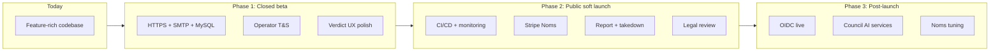

# Launch readiness — product assessment

Living checklist from a **product development review** (2026-05-24). Use alongside [`PRODUCT_GUIDE.md`](PRODUCT_GUIDE.md) (product & brand canon), [`README.md`](README.md) (doc map), [`SYSTEM_THEORY.md`](SYSTEM_THEORY.md) (ecosystem backlog), [`EVOLUTIONARY_BIOLOGY_REVIEW.md`](EVOLUTIONARY_BIOLOGY_REVIEW.md) (ecological analysis), [`POLITICAL_SCIENCE_REVIEW.md`](POLITICAL_SCIENCE_REVIEW.md) (governance legitimacy), [`SOCIAL_PSYCHOLOGY_REVIEW.md`](SOCIAL_PSYCHOLOGY_REVIEW.md) (wellbeing analysis), [`CLINICAL_PSYCHOLOGY_REVIEW.md`](CLINICAL_PSYCHOLOGY_REVIEW.md) (clinical harm assessment), [`TRUST_AND_SAFETY.md`](TRUST_AND_SAFETY.md) (safety roadmap), and [`AGENTS.md`](../AGENTS.md) (load-bearing rules).

**Last reviewed:** 2026-08-15 — **council share + invite pipelines**, scheduler/lease hardening, job-queue health probes (`/health/status`, `/health/jobs`), invite re-chain + contact grounding. Prior: 2026-08-14 (login-refund toast, Stripe beta checkout). Prior: 2026-08-12 — godmother outreach, domain reputation, inline body URL block, on-call ([`OPS_ON_CALL.md`](OPS_ON_CALL.md)), Epic portrait on beta, CI/CD disk hardening. Prior: 2026-08-11 (Epic portrait consolidation). Prior: 2026-07-24 (async face capture). Prior: 2026-07-23 (civic standing literacy). Prior: 2026-06-05 test-gated CI/CD confirmed.

---

## Executive summary

256.app is **functionally rich and internally coherent** — and as of 2026-05-30 it is **deployed and running as a live closed beta** at [`beta.twofivesix.app`](https://beta.twofivesix.app/login). Core product code (auth, onboarding, social graph, feed, judiciary, rating lifecycle, Noms, **invitations, profiles, blocks, account/entity lifecycle, password reset, operator console**) is **built and hosted**. The hosting gates that previously blocked closed beta — hosted MySQL + backups, HTTPS with `SECURE_COOKIES`, correct `PUBLIC_APP_URL`, and SMTP — are **resolved**. A **confirmed test-gated CI/CD pipeline** ([`.github/workflows/deploy.yml`](../.github/workflows/deploy.yml), [`.github/workflows/test.yml`](../.github/workflows/test.yml), runbook [`DEPLOY_BETA.md`](DEPLOY_BETA.md)) runs **`cargo test`** + Playwright **`test:public`** on push to `main` (PRs via [`ci.yml`](../.github/workflows/ci.yml)), then rebuilds and ships both binaries to beta — **verified green 2026-06-05**; **Epic portrait consolidation redeploy confirmed 2026-08-12** after CI runner disk + VM staging-order fixes. The 2026-05-29 **Panoply operator console** (`/home/ops`) closed the largest public-launch hard blocker (in-product acute-harm operator tooling + audit log). Public launch now turns on **vendor safety integrations (hash API + hotline), monitoring, legal review, minors gating, operator staffing, and polish** rather than absent core flows or missing infrastructure.

| Launch tier | Readiness | Notes |
|-------------|-----------|-------|
| **Internal / dogfood** | ~97% | Full stack locally + hosted: auth, onboarding, feed, posts, graph, judiciary, Noms, profile/invite/block flows, voluntary delete, password reset, operator console, godmother recovery, domain reputation |
| **Closed beta** (invite-only) | ✅ **Live** (~99%) | Running at `beta.twofivesix.app`: hosted MySQL + backups, HTTPS + `SECURE_COOKIES`, `PUBLIC_APP_URL`, SMTP, **test-gated CI/CD deploy** (2026-06-05; **Epic portrait + avatar redraw live 2026-08-12**). **Civic standing literacy** (2026-07-23); **godmother_outreach** (Jul); **domain reputation + inline body URLs** (2026-08-12); **login-refund toast** (2026-08-14); **council share/invite pipelines** (2026-08-14–15); **scheduler + queue health probes** (2026-08-15); on-call [`OPS_ON_CALL.md`](OPS_ON_CALL.md) (2026-08-12). **Residual:** verdict-UX polish, **VM boot disk resize** (10 GB), confirm **`OPS_DIGEST_LIVE=1`** + council jobs draining on beta ([`DEPLOY_BETA.md`](DEPLOY_BETA.md) § Job scheduler), optional **`COUNCIL_WEB_SEARCH_*`** for invite discovery, edge-only godmother |
| **Public launch** | ~76% | Above + vendor hash/hotline, monitoring, dedicated safety policy page, notification mute, Stripe/Noms monetization verified at scale, legal + minors, full Playwright `test:smoke` in CI |

---

## Current build priorities (August 2026)

Canonical backlog detail: [`SYSTEM_THEORY.md`](SYSTEM_THEORY.md) § Current priorities. Core flows are **built** — next leverage is **beta ops hardening, verdict polish, and abuse monitoring**.

| Tier | Focus | Top items |
|------|-------|-----------|
| **1 — Finish closed beta** | Stable invite-only cohort | **VM boot disk resize** (10 GB → 20–30 GB); **beta scheduler sanity** — `/health/status` (`ops_digest_live`, `job_queue_pending_due`), `/health/jobs`; emergency-filing pattern monitoring (OIDC + **32 Nom** signup grant) — see [`ADVERSARIAL_USER_REVIEW.md`](ADVERSARIAL_USER_REVIEW.md) |
| **2 — Beta quality** | Felt fairness matches coded fairness | ~~standing literacy~~ **shipped (2026-07-23)**; ~~godmother assisted recovery~~ **shipped (Jul 2026)** — welcome + global failing + global recovery; ~~**login-refund toast**~~ **shipped (2026-08-14)**; optional pre-onboarding standing primer; post-card civic shortcut (pre-selected clause) |
| **3 — Abuse resistance** | Close top adversarial path | Domain reputation + inline body URL block **shipped (2026-08-12)**; edge-only godmother failing notices backlog |
| **4 — Public launch** | Open signup gates | Vendor hash API + hotline (16); dedicated safety policy; legal/minors; monitoring; `test:smoke` in CI — **defer paid vendor spend** until traffic/revenue justify (rollback note below) |

**Do not sprint yet:** post/moderation Nom costs, ops metrics dashboard, Noms economic tuning, profit/NPO automatic death.

### Marketing & closed-beta outreach

---

## Differentiated features (worth highlighting)

These are coherent product thesis, not checkbox features:

1. **AI Council onboarding anchor + participatory stewards** — Users pick one of 12 intention-aligned AI guides; system wires godmother → AI moderator → community membership edges. Councillors then **actively steward** their flocks: **`godmother_outreach`** (welcome on `select_godmother`, global failing notice, global recovery when rating ≥ 0.66), 15‑min **thread replies** (peer + own steward communities), daily **`council_share_shortlist`** funnel (32→8→read→publish per councillor), and daily **`council_invite_*`** four-stage pipeline (own-steward articles → person discover → contact resolve → review-routed invite with budget-aware re-chain) — [`PRODUCT_GUIDE.md` § AI Council](PRODUCT_GUIDE.md#ai-council).
2. **Community-native judiciary** — Emergency safety, civic disputes, membership reviews, constitutional amendments, community profile amendments, community re-parent, and AI council appeals — with √n jury sizing, rating-weighted ⅔ thresholds, automatic seat refill (~15s tick), and evidence snapshots (`src/social/judicial/`, `AGENTS.md`).
3. **Rating-as-fitness ecosystem** — Scalar ratings drive failing UI (**human** red `@handle` owner-only; **community** failing public), **phased human login-idle** pruning (δ=0.035; warning 21d, decrements from 28d; **login refund**), and **death at 0** with graph reparenting / user deletion (`src/social/community_graph/`, `docs/COMMUNITY_GRAPH_MANAGEMENT.md`).
4. **Dunbar-scale human graph** — Hard **256** connection cap with **symmetric** community→global rating spillover (±δ/6) (`src/social/connections.rs`).
5. **Constitutional governance** — **Root charter v2 (16 points, shipped 2026-05-29)** in DB/UI with consent **`v2-2026-05-29`**. **Emergency + civic split (2026-05-28)** on post filing: §4.1–§4.7 suppress-first; other clauses civic jury from filing. Points **15–16** (sanitation + reporting) in charter; vendor hash API and hotline automation remain ops backlog. See [`ROOT_CONSTITUTION_PROPOSAL.md`](ROOT_CONSTITUTION_PROPOSAL.md).
6. **Noms economy** — Signup grant + Stripe pack purchases accrue currency (cap 256); entity founding, judicial, and AI actions debit from a single code schedule (`src/pricing.rs`, `src/social/noms/`). **Ad-free feed** — no ad accrual.
7. **512×512 face pipeline** — Client/server image standard; async job queue (`face_portrait_pipeline`); no stored biometrics; Vertex vision + Imagen via **`ai_gateway` only**; Epic **style plate v6** + colour card + multi-sample likeness pick ([`BETA_AI_SETUP.md`](BETA_AI_SETUP.md), [`PRODUCT_GUIDE.md`](PRODUCT_GUIDE.md) § Onboarding portrait pipeline).
8. **Scoped read materialization** — Relationship-derived visibility with async materialized fast path (`entity_read_scope` + live view fallback).
9. **Panoply operator console** — Invite-only `@panoply` clearance + `/home/ops` console: operator emergency/civic filing (Noms + cap waived), vacate, eject (platform ban), session kill, domain block, all audited (`safety_operator_action`); operators are concealed from non-operators and fitness-death immune (`src/social/panoply/`, [`TRUST_AND_SAFETY.md`](TRUST_AND_SAFETY.md) § Panoply operator console).

---

## Domain scorecard

| Domain | Status | Evidence |
|--------|--------|----------|
| **Auth** | ✅ Solid | Email/password, verification, sessions, rate limits — `src/routes/auth.rs`. **2026-06-05:** browser GETs to protected routes without a valid session redirect to `/login?login=1` (JSON/API unchanged) — `src/middleware/auth_gate.rs` |
| **Onboarding** | ✅ Enforced | Email → terms consent → face capture → profile → godmother → verified — `src/status/mod.rs` |
| **Social graph** | ✅ Rich | Entity types, typed human connections, community join policies, invites, 256 cap — `src/social/` |
| **Profiles & invitations** | ✅ Rich | Private overlay + page, AJAX actions, feed invites, self human edit/password/delete, **owner-only civic standing block** (global + per-community edge, 2026-07-23), **human block list** + feed/thread filter, owner entity edit/delete — `blocks.rs`, `entity_profile_edit.rs`, `private_profile.rs` |
| **Feed & posts** | ✅ Working | Audience-scoped feed, threads, engagement, links, **domain preview reputation bands** + **inline body URL block** at post create — `src/social/feed.rs`, `src/content/domain_reputation.rs` |
| **Communities** | ✅ Working | Constitution, amendments, join policies, lifecycle/death, re-parent |
| **Judiciary** | ✅ All triggers live | Emergency safety + civic dispute + membership + amendments + re-parent + civic council appeal |
| **Public discovery** | ✅ Working | `/public/{handle}`, JSON API; dead entities hidden |
| **Noms / monetization** | ✅ Live (Stripe) | Signup grant + **Payment Element** pack purchase (Civic always available); **beta test-card checkout confirmed 2026-08-14**; **production Stripe activation required before public launch**; judicial spend wired; council portraiture/artwork UI incomplete |
| **AI** | ✅ Mostly live on beta | `ai_gateway` + **live async face pipeline**; council moderation appeals; **autonomous batch jobs** (reply tick, share funnel, invite funnel — review inbox only); optional **web search** for invite person discovery (`COUNCIL_WEB_SEARCH_*`); priced portraiture/artwork UI still partial |
| **Trust & safety (user agency)** | ✅ Mostly live | Emergency + civic filing; graph block; **`content_domain` denylist** + **preview reputation bands**; **inline body URL blocklist**; **`safety_sanitation_event`** + face-capture hash gate stub; **Panoply operator console** + **closed-beta on-call** ([`OPS_ON_CALL.md`](OPS_ON_CALL.md)). **Ops backlog:** vendor hash API, hotline (16), notification mute — [`TRUST_AND_SAFETY.md`](TRUST_AND_SAFETY.md) |
| **Deploy / ops** | ✅ Verified | **Test-gated CI/CD** confirmed 2026-06-05; Epic redeploy 2026-08-12 ([`DEPLOY_BETA.md`](DEPLOY_BETA.md)). **2026-08-15:** scheduler lease extension + stale-period job skip; public **`/health/status`** + **`/health/jobs`** queue probes. **2026-08-12:** CI runner disk hardening; VM disk reclaim before SCP. **Gaps:** 10 GB VM boot disk; no Docker; no monitoring/alerting; manual rollback |
| **QA / test pipeline** | ✅ CI (public) | **`cargo test`** (~42 integration binaries, incl. **`council_share_pipeline`**, **`council_invite_pipeline`**, **`council_thread_reply`**, **`nom_purchase`**, **`jobs_enqueue_policy`**) + Playwright **`test:public`** — PRs via [`ci.yml`](../.github/workflows/ci.yml); push to `main` via deploy workflow only. Portrait lib tests (`portrait_timeout`, `epic_portrait`). **Not in CI yet:** full `test:smoke`. **Gap:** visual regression |

**Integration tests:** ~42 binaries under `tests/` — judicial (triggers sweep, verdict, lifecycle), **emergency moderation**, **harm-class routing**, membership review, graph death/inactivity, scope recalc, public dead discovery, engagement threads, **human blocks**, **feed blocks**, **feed audience visibility**, community invite search, **voluntary death**, **account security**, **panoply ops**, **`godmother_outreach`**, **`domain_reputation`**, **`m2_avatar_redraw`**, **`nom_purchase`**, **`council_thread_reply`**, **`council_share_pipeline`**, **`council_invite_pipeline`**, **`jobs_enqueue_policy`**, **`content_domain_lifecycle`**, **`m1_public_api`** (HTML auth redirect contract). **Browser tests:** Playwright in [`e2e/`](../e2e/) — `test:public` in CI (14 guest/login scenarios × desktop + mobile). **Gap:** full E2E for community re-parent two-phase settlement; authenticated `test:smoke` not yet in CI.

---

## Implemented and live (product surfaces)

### Auth & account lifecycle
- Registration, login, logout, resend verification — `src/routes/auth.rs`
- **Google OIDC** — `POST /auth/oidc/google/start`, `GET /auth/oidc/callback`, password-gated `/auth/oidc/link` — `src/routes/auth_oidc.rs`, `src/auth/oidc/`
- **reCAPTCHA v3** on register, login, OIDC start/link — `src/auth/recaptcha.rs`, `src/auth/captcha_gate.rs`
- **Post-auth consent** — `POST /me/terms-consent`; charter + 16+ attestation after session (OIDC-safe) — `src/auth/post_auth.rs`
- Email verification tokens — `src/auth/verification.rs`
- **Verify link auto-login:** `GET /verify-email?token=…` verifies email, sets session cookie, redirects via `post_auth::next_path_after_auth`
- Session cookies, sliding refresh, verified-email gate
- **Change password** — `POST /me/change-password` (self profile two-step UI; session rotation)
- **Delete account** — `POST /me/account/delete` (ack + password; `user_requested` death source; voids open judicial cases)
- **Block list** — `GET /me/block-list`, `POST /me/blocks/unblock`; profile block via `POST /home/private-profile-block/{handle}`
- **Entity owner edit / delete** — `PATCH /me/entities/{handle}`, `POST /me/entities/{handle}/delete` (profit, non-profit, gathering)
- Legal pages: `/terms`, `/conditions`, `/privacy`
- Dev-only bypass: `/dev/auth/login-as` (refuses startup unless `HOST` is loopback; must be off on beta/production VM)
- **`GET /account`** — JSON smoke stub only (not the account settings UI)

### Onboarding (staged, enforced)

1. **Auth:** email/password (+ verify) or Google OIDC — `POST /auth/register`, `POST /auth/login`, OIDC routes
2. **Consent:** Root charter + 16+ attestation — `POST /me/terms-consent` → `users.terms_consent_version` (`/home?onboarding=consent`; UI **Step 1/4**)
3. Email verified (+ auto-login on verify link for password path)
4. **Step 2/4 — Human Finder:** Face capture (512×512) — `POST /me/face-capture` (202 + poll `GET /me/face-capture/status/{pending_id}`); async `face_portrait_pipeline` job; submit shows spinner + wait copy (buttons hidden)
5. **Step 3/4 — About You:** Human profile — `POST /me/human-profile`
6. **Step 4/4 — Choose Your Guide:** AI Council godmother — `/me/godmother-options`, `/me/godmother` (2×6 grid; community label only)
7. Composite `verified` status unlocks posting — `require_posting_rights`

**Product doc:** [`docs/ONBOARDING.md`](ONBOARDING.md)

### Core social graph
- Entity types: human, community, gathering, profit, non_profit
- Human connections: friend / family / colleague (pending → verified); accept / decline / **block on invite** / disconnect
- Community join: open (instant), reviewed (membership review), invite-only (owner send)
- Follow (profit/NPO), RSVP (gatherings), leave community
- **256** human connection cap — `src/social/connections.rs`
- Scoped read security — `entity_read_scope` + `vw_entity_read_scope_live` fallback

### Private profiles & invitations
- **Full page:** `GET /home/profile/{handle}`; **overlay fragment:** `GET /home/private-profile-card/{handle}`
- AJAX profile actions (select-on-change, JSON responses) — `static/js/home-shell.js`
- **Human block:** profile CTA, connect-as Block, feed/thread/search/mention filter, connection rail, profile feed — `src/social/blocks.rs`
- **Outstanding invitations** panel on home feed (human + community) — `src/social/pending_invitations.rs`
- Topbar connection meter `{used}/256 - @handle` while viewing profiles
- Self human: edit profile (`PATCH /me/human-profile`), avatar redraw (16 Noms), change password, delete account, manage block list, **view civic standing** (global + per-community edge; learn-more → How it works `#civic-standing`)
- Self entity (owner): edit + voluntary delete on profit / non-profit / gathering profiles
- Membership review apply/cancel with free-cost label on reviewed communities
- See [`PRODUCT_GUIDE.md`](PRODUCT_GUIDE.md) § Invitations & private profiles

### Feed & posts
- Home feed with audience-scoped visibility
- Post creation (text, audience, content links)
- Threaded comments, votes, feel labels
- Conversation rating settlement job
- OG preview / content link ingest

### Communities & constitution
- Parent tree, effective constitution walk
- **Root Operating Charter** — **v2:** 16 points in DB/UI (migration `20260529120000_*`); consent **`v2-2026-05-29`** — [`ROOT_CONSTITUTION_PROPOSAL.md`](ROOT_CONSTITUTION_PROPOSAL.md)
- Join policies (open vs reviewed)
- Constitutional amendment filing (32 Noms)
- Community profile amendment filing (32 Noms)
- Community graph lifecycle (failing, inactivity, death, human death, **voluntary delete**, `graph_death_source` metadata)

### Judiciary (all triggers live)
| Trigger | Cost | Notes |
|---------|------|-------|
| Emergency safety (Root §4.1–§4.7) | 1 Nom | Post **`suppressed`**; case **`contained`**; **no jury** until author contests (1 Nom); 3 filings/filer/UTC day; one emergency/post |
| Civic dispute (other charter clauses) | 1 Nom | Post **`under_judicial_review`**; human jury from filing; serious **7d** / regular **21d** `no_jury` → post **`flagged`** |
| Emergency contest (author) | 1 Nom | Opens jury on uncontested emergency case |
| Membership review | Free | Reviewed join policy communities |
| Constitutional amendment | 32 Noms | Human jury only; uncapped √n |
| Community profile amendment | 32 Noms | About / intention / join policy |
| Community re-parent | 64 Noms | Two-phase human jury |
| Civic dispute council appeal | 32 Noms | AI Council of 12; **civic disputes only** |

Legacy **`post_moderation`** rows remain readable; new filings use `emergency_safety` / `civic_dispute`.

Infrastructure: jury nomination/refill scheduler, weighted votes, abstain/decline, evidence snapshots, **depersonalized juror corpus**, juror safety instructions (items 4/7/11/14), civic `no_jury` keeps thread **flagged**, emergency uncontested T+3 standing job, bad-faith filer **−6×δ** when jury clears post / author wins contest, email notifications (jury summons, standing/inactivity, **emergency author mail**).

### Monetization (Noms)
- Wallet: `social_human.ai_tokens`, cap 256
- Accrual: signup grant (+32 Noms), daily login (+1/UTC day), jury duty (+3/case), Stripe pack purchases — `src/nom_packs.rs`, `src/social/noms/mod.rs`
- UI: topbar `noms.wallet_aria`
- Ledger: `social_human_ai_token_ledger`
- Judicial spends wired through `noms::spend_for_service_tx`
- **Avatar redraw live** (16 Noms, `CouncilAvatarRefresh`) — self profile toolbar → face capture

### AI features
- AI Council of 12 (seeded, agent specs in `agents/council/`)
- `ai_gateway` binary (gRPC, Vertex / Gemini for council business functions) — **sole holder of GCP/Vertex credentials** for vision + Imagen (2026-07-24)
- **Async face pipeline:** validate → colour card → Imagen 3-sample pick + QA gates; onboarding + avatar redraw
- Council moderation on post-dispute appeals — `src/social/judicial_council.rs`
- **Council participatory activity (shipped 2026-06–08):** 15‑min **`council_reply_tick`** (peer + own communities); daily **`council_post_tick`** → staggered **`council_share_shortlist`** → read → publish (`social::council_share_pipeline`); daily **`council_invite_tick`** → **`council_invite_article_pick`** → person discover → contact resolve → compose send — review inbox only via **`deliver_platform_invite_for_review`**; snippet email verify + profile URL grounding; budget-aware re-chain (`social::council_invite_pipeline`) — [`PRODUCT_GUIDE.md` § AI Council](PRODUCT_GUIDE.md#ai-council), [`BETA_AI_SETUP.md`](BETA_AI_SETUP.md)
- **`godmother_outreach` unified job (shipped Jul 2026):** welcome on `select_godmother`, global failing notice (after failing email), global recovery when rating ≥ 0.66 (lifecycle flush); private `@private` posts in steward AVC voice — `src/social/godmother/`, `tests/godmother_outreach.rs`

### Public discovery
- `/public/{handle}`, `/api/public/entity-profile/{handle}`
- Mobile-first UI, i18n (en/fr)

---

## Implemented but rough / incomplete

| Item | Status | Notes |
|------|--------|-------|
| **Post-verdict feed UX** | **Shipped (2026-06-30)** | `@256` structured notices for human/council/`no_jury` removed stubs + exonerated banners; emergency author outcomes — `ui.post_verdict.*`, `src/ui/post_card/feed.rs` |
| **AdSense** | **Removed** (2026-06-29) | Feed is ad-free; Noms accrue via signup grant + Stripe packs only |
| **Council AI batch jobs** | **Live (beta)** | Share + invite funnels shipped; review-routed invites only; **`COUNCIL_WEB_SEARCH_*`** optional for invite discovery — confirm scheduler + queue health on VM ([`DEPLOY_BETA.md`](DEPLOY_BETA.md) § Job scheduler) |
| **Council AI paid services** | Partial | `CouncilAvatarRefresh` **live** (16 Noms); `CouncilPortraiture` / `CouncilArtworkBrief` priced, no UI |
| **Forgot password / email reset** | **Live** | `POST /auth/forgot-password`, `GET /reset-password`, token table (`migrations/20260528120000_password_reset.sql`), `src/auth/password_reset.rs`, `send_password_reset_email`; account reactivation route too |
| **Post/moderation Nom costs** | Branded posts **live** | Profit **4** / non-profit & gathering **2** Noms on publish (`BillableService::BrandedPost*`); human posts free; unaffordable brands shown red + disabled in Post as picker; 3 Nom moderate still backlog |
| **Enhanced verification tiers** | Schema + hooks | Google Places search routes exist; peer-facing Enhanced/Professional surfaces limited |
| **Community re-parent E2E tests** | Pool math only | `tests/community_reparent_subtree_pool.rs`; full judicial settlement test missing |
| **OIDC social login** | **Live** | Google OIDC — `src/auth/oidc/`, `src/routes/auth_oidc.rs`; env in `.env.example`; beta needs matching redirect URI + reCAPTCHA domains |
| **Verbose AI errors** | Dev default | `VERBOSE_AI_ERRORS` defaults true — hide in production |
| **Post-card civic shortcut** | Partial | Feed cards link eligible posts to `/home/judicial/post/{id}` (`src/ui/post_card/feed.rs`); not on public cards; no pre-selected clause from the card yet |
| **Safety & Crisis** | **Live** | `GET /safety` → Safety & Crisis legal card (`ui.legal.safety_body` + hotline panel); crisis registry in `config/crisis_resources.en.json` |
| **Operator console (Panoply)** | **Live** | `/home/ops` operator dashboard + `safety_operator_action` audit; **v1 on-call shipped** ([`OPS_ON_CALL.md`](OPS_ON_CALL.md), Safety card contact, 2026-08-12); single structural operator (`@sphinx`) seeded; roster expansion backlog |
| **Recovery ecology UX** | **Partial** | **Godmother assisted recovery shipped** (Jul 2026 — welcome + failing + recovery); **civic standing literacy shipped** (2026-07-23); **login-refund toast shipped** (2026-08-14); edge-only godmother failing notices backlog |
| **Root charter v2 + hash gate** | **Partial (shipped 2026-05-29)** | 16-point charter + `safety_sanitation_event` + face-capture SHA-256 stub live; vendor PhotoDNA-class API still backlog — [`ROOT_CONSTITUTION_PROPOSAL.md`](ROOT_CONSTITUTION_PROPOSAL.md) |

---

## Documented but not built (intentional deferrals)

From [`PRODUCT_GUIDE.md`](PRODUCT_GUIDE.md) and [`SYSTEM_THEORY.md`](SYSTEM_THEORY.md):

- Full **anathema** repercussions beyond moderation status
- Post deliberation / chat on membership-review cases
- Platform **trust & safety** automation — **shipped (2026-05-29):** charter points 15–16, sanitation audit, hash gate stub, **Panoply operator console + audit log**; **shipped (2026-08-12):** inline body URL block, domain preview reputation, **v1 on-call** ([`OPS_ON_CALL.md`](OPS_ON_CALL.md)); **ops backlog:** vendor hash API, hotline (16), operator roster expansion, geo withhold, notification mute
- Ops/ecosystem metrics dashboards (`no_jury` rate, scope lag, etc.)
- Noms economic homeostasis tuning with production analytics
- Rating/constitution explainability UX — **partial:** How it works § Civic standing + self-profile block shipped (2026-07-23); **godmother assisted recovery shipped** (Jul 2026 — replaces recovery checklist); **login-refund toast shipped** (2026-08-14); optional onboarding primer backlog
- Profit/NPO **rating-zero** automatic death (voluntary owner delete **is live**)
- Keystone/charter governance automation
- OIDC Apple sign-in (deferred)
- Council portraiture / artwork brief UI (avatar redraw **is live**)
- Zero-Nom non-acute civic filing (v2 point 13) — Class A/B vendor sanitation path (not built); emergency/civic filing surface handles §4.x and other clauses today

---

## Shipped 2026-05-28 (greenfield emergency + civic moderation)

| Item | Evidence |
|------|----------|
| **Triggers** | `emergency_safety`, `civic_dispute`; `post_moderation` deactivated for new filings |
| **Post statuses** | `suppressed` (emergency); `under_judicial_review` (civic open case) |
| **Case status `contained`** | Uncontested emergency until author contests |
| **§4.1–§4.7 sub-clauses** | Points 401–407 on Root charter; point 4 preamble non-selectable |
| **Contest route** | `POST /home/judicial/post/{id}/contest` (1 Nom) |
| **Caps** | 3 emergency filings/filer/UTC day; one emergency/post |
| **Standing job** | `emergency_standing_settlement` — uncontested T+3 Loathed-equivalent |
| **Safety ban** | Contest loss → platform `blocked` (`human_safety_ban_tx`) |
| **Author emails** | `src/email/notify/moderation.rs` — filed, contest, standing |
| **Tests** | `tests/emergency_moderation.rs` |

## Shipped 2026-05-29 (Root charter v2)

| Item | Evidence |
|------|----------|
| **16-point Root charter** | `migrations/20260529120000_root_operating_charter_v2.sql` |
| **Points 15–16** | DB + `locales/en.json` + `root_constitution_content_fragment.html` |
| **`safety_sanitation_event`** | `migrations/20260529121000_safety_sanitation_event.sql`; `src/social/safety/` |
| **Media hash gate** | Face capture; `MEDIA_HASH_BLOCKLIST` env |
| **Terms consent** | `v2-2026-05-29` — `human_onboarding::CURRENT_TERMS_CONSENT_VERSION` |

## Shipped 2026-06-10 (Search/Add, authorship, privacy, recruitment, jury UX)

| Area | Shipped |
|------|---------|
| **Search / Add** | Shared avatar row layout for search + recommendations; standard loader during fetch; rail refocus re-runs query (`static/js/home-shell.js`, `entity-recommendations.js`) |
| **Branded posts** | Communities removed from Post as picker — human, profit/non-profit, gathering only (`GET /me/posting-entities`) |
| **Human failing privacy** | Red failing `@handle` owner-only — same model as rating stars (`src/ui/entity_handle.rs`) |
| **Friend invite gate** | No recruitment mail to registered emails; verified peers get in-UI `@handle` link (`recruitment::precheck_friend_invite_email`) |
| **Jury summons** | Severity notice before workspace on acute/serious cases; quota-free abstention on those paths |

See [`PRODUCT_GUIDE.md`](PRODUCT_GUIDE.md) changelog 2026-06-10.

## Shipped 2026-08-12 (beta deploy — Epic portrait + CI/CD hardening + T&S)

| Area | Shipped |
|------|---------|
| **Beta deploy confirmed** | Full `test` → `build` → `deploy` green on `main` — Epic portrait consolidation + avatar redraw client fixes live at `beta.twofivesix.app` |
| **CI runner disk** | Test jobs restore `rust-cache` only (`save-if: false`) + `cargo clean` after tests; build caches release artifacts; `scripts/ci/free_runner_disk.sh`; cache key `256-v2` |
| **No duplicate CI on `main`** | [`ci.yml`](../.github/workflows/ci.yml) runs on PRs only; push to `main` → deploy workflow alone |
| **VM deploy order** | Disk reclaim **before** SCP → `install` from `~/deploy-staging/` → restart → remove staging copies (fixes accidental wipe between SCP and install) |
| **VM disk script** | [`scripts/ops/cleanup_beta_disk.sh`](../scripts/ops/cleanup_beta_disk.sh) — manual + automated pre-SCP reclaim |
| **Domain preview reputation** | Reputation bands on OG preview / content link ingest — `src/content/domain_reputation.rs` |
| **Inline body URL block** | Post-create denylist for URLs in post body text — blocks at publish time |
| **Closed-beta on-call v1** | [`OPS_ON_CALL.md`](OPS_ON_CALL.md); Safety legal card operator contact; primary **@sphinx** |
| **Tests** | `tests/m2_avatar_redraw.rs`, `tests/domain_reputation.rs`; portrait timeout budget unit tests in `src/ai/portraiture.rs` |
| **Avatar redraw (client)** | Face-api preload for redraw mode; gRPC timeout budget (~90s/predict); cache bust `home-shell.js?v=20260811-redraw-models2` |

**Still backlog:** resize GCP boot disk from 10 GB → 20–30 GB; GitHub Actions artifact/log retention set to **28 days**.

See § Shipped 2026-08-11; [`DEPLOY_BETA.md`](DEPLOY_BETA.md) § CI runner disk, § Disk cleanup.

## Shipped 2026-08-15 (council pipelines + scheduler hardening)

| Area | Shipped |
|------|---------|
| **Council share funnel** | Daily coordinator → per-councillor **`council_share_shortlist`** → read → publish; `src/social/council_share_pipeline.rs`; migration `20260814120000_council_share_pipeline.sql` |
| **Council invite funnel** | Four-stage pipeline: article pick → person discover → contact resolve → compose send; review inbox only on beta; re-chain after successful review-routed send (cap **3 chain starts/day**); snippet-first email + profile URL grounding — `src/social/council_invite_pipeline.rs`, `src/social/council_invite_contact.rs`; migration `20260814140000_council_invite_pipeline.sql` |
| **Scheduler / lease** | Default **`JOB_QUEUE_LEASE_SECS=1800`**; lease extend during long council ticks; stale-period skip for reply/share member jobs — `src/jobs/queue.rs`, `src/social/council_jobs.rs` |
| **Ops health probes** | **`GET /health/status`** — `ops_digest_live`, `job_queue_pending_due`, `scheduler_tick_count`; **`GET /health/jobs`** — queue snapshot + council pipeline readiness — `src/routes/health.rs` |
| **Tests** | `tests/council_share_pipeline.rs`, `tests/council_invite_pipeline.rs`, `tests/council_thread_reply.rs` |

**Beta verify:** `/health/status` shows `scheduler_enabled: true`, `ops_digest_live: true` (set `OPS_DIGEST_LIVE=1` or unset on VM); `/health/jobs` shows council job types draining; optional `COUNCIL_WEB_SEARCH_*` for invite person discovery — [`BETA_AI_SETUP.md`](BETA_AI_SETUP.md).

## Shipped 2026-07 (godmother assisted recovery)

| Area | Shipped |
|------|---------|
| **`godmother_outreach` unified job** | Single job unifies welcome + global failing + global recovery — `src/social/godmother/` |
| **Welcome** | Triggered on `select_godmother` — steward AVC voice post to user's `@private` |
| **Global failing** | Triggered after global failing email (`rating < 0.66`) — godmother outreach in steward voice |
| **Global recovery** | Triggered on lifecycle flush when rating ≥ 0.66 — recovery encouragement post |
| **Private posts** | Outreach publishes as private `@private` posts in steward AVC voice |
| **Tests** | `tests/godmother_outreach.rs` |

**Still backlog:** edge-only failing notices (community `member_of` edge, not global).

See [`PRODUCT_GUIDE.md`](PRODUCT_GUIDE.md) § AI Council; [`DESIGN_BIAS_RECOVERY.md`](DESIGN_BIAS_RECOVERY.md).

## Shipped 2026-08-11 (Epic portrait consolidation)

| Area | Shipped |
|------|---------|
| **Colour card** | `portrait_colour_card_v1` replaces canonical-appearance prose; JSON injected into compact Imagen prompt only |
| **Style plate v6** | Even flat lighting; subject `[1]` + style `[3]` only — no face-mesh Imagen ref |
| **Multi-sample QA** | `sampleCount: 3`; mouth-void gate; likeness-grid pick vs prepared subject in `ai_gateway` |
| **Avatar redraw** | In-feed face-capture card + paid redraw (16 Noms); portrait timeout budget; beta manual QA confirmed |
| **Dead code removed** | Face-mesh generation path, legacy style plates v1–v5, unused canonical-appearance assets |

**Manual QA:** avatar redraw with glasses — editorial bust on `#000000`, gateway log `portrait likeness pick`. See [`e2e/README.md`](../e2e/README.md) § Manual QA row 11.

## Shipped 2026-07-24 (Epic onboarding portrait pipeline)

| Area | Shipped |
|------|---------|
| **Async face capture** | `POST /me/face-capture` → 202 + `face_capture_pending` row; client polls status; `face_portrait_pipeline` job (`src/social/face_capture_pending.rs`) |
| **Gateway-only Vertex** | Web app: `AI_GRPC_ENDPOINT` only — no `GOOGLE_APPLICATION_CREDENTIALS` on `twofivesix`; Imagen + vision on `ai_gateway` |
| **Vision gates** | `face_capture_validate_v1` (accept/reject JSON); **`portrait_colour_card_v1`** JSON from neutral capture (transient — not stored) |
| **Epic style plate** | `agents/council/rag/epic/style-plate-bust-v6.png` → Imagen `REFERENCE_TYPE_STYLE` `[3]`; prepared subject `[1]`; compact prompt (`enhancePrompt: false`) |
| **Multi-sample pick** | `sampleCount: 3`; mouth-void gate; likeness grid vs prepared subject; up to 2 batches in `ai_gateway` |
| **Likeness tuning** | Style plate = medium/composition only; identity from subject ref + colour card; operator guide in `portrait_style_guide.txt` (human-only, not injected) |
| **Onboarding gate** | Middleware + client redirects keep funnel order (consent → face → profile → godmother) — `src/auth/onboarding_gate.rs` |
| **Dev flags** | `SKIP_FACE_VISION_VALIDATE=1` (loopback only); `DEV_AUTH_BYPASS=1` for generous local Vertex attempt budget |

**Deploy note:** Ship `agents/council/` assets with each release (`git reset` on VM). **Manual QA:** fresh capture or avatar redraw (16 Noms) — existing avatars unchanged until redraw.

**Still backlog:** likeness QA across lighting/angles; face-only style plate v2 if style plate leaks identity; pre-face-capture standing primer.

See [`PRODUCT_GUIDE.md`](PRODUCT_GUIDE.md) changelog 2026-07-24; [`BETA_AI_SETUP.md`](BETA_AI_SETUP.md).

## Shipped 2026-07-23 (civic standing literacy)

| Area | Shipped |
|------|---------|
| **Self-profile civic standing** | Owner-only `Civic standing` block on human self private profile — global stars + numeric, per-community `member_of` edge rows (full profile); summary overlay shows global only (`profile_civic_standing_block_html`, `MemberCommunityStanding` in `private_profile.rs`) |
| **Published rules annex** | How it works legal card § **Civic standing** (`ui.legal.how_body`, anchor `#civic-standing` via `[civic-standing]` headings in `legal_card.rs`); footer + profile **Learn more** link |
| **Charter alignment** | Root point **5 (self-knowledge)** — owner sees own scores; point **8 (published rules)** — plain-language standing rules in How it works (coefficients stay in code, not charter) |
| **Privacy preserved** | No human standing on other profiles, public API, or peer views; failing/inactivity owner notices unchanged; `@panoply` concealment unchanged |

**Manual QA:** sign in → own full profile → civic standing visible; peer profile → no scores; `/login?legal=how#civic-standing` → Civic standing section. See [`PRODUCT_GUIDE.md`](PRODUCT_GUIDE.md) § Civic standing.

**Still backlog:** optional pre-face-capture standing primer in onboarding; Playwright coverage.

## Shipped 2026-07-22 (profile messaging, shell navigation, judicial preview, Nom checkout)

| Area | Shipped |
|------|---------|
| **Private message shortcut** | Connected human private profile header → create-post with `For: @private, @{handle}` (`profile_secondary_actions_html`, `home-shell.js` preset) |
| **Post-actions sprite** | `icon-private-message`; cache-bust `?v=` on `/static/icons/post-actions.svg` in `post_icons.rs` / `rail.rs` / `nom_icon.rs` |
| **Feed scroll on dismiss** | Back/cancel on create-post, search/add, create-entity, profile dismiss, and browser-back to `/home` scrolls feed to top |
| **Judicial filing preview** | Post card on `/home/judicial/post/*` (and appeal/contest pages) omits engagement bar — read-only corpus |
| **Nom purchase modal** | Stripe Payment Element (card-only); Civic pack always available; secondary Cancel; no default pack selection |

**Manual QA:** [`e2e/README.md`](../e2e/README.md) § Manual QA (2026-07-22). **Automated Playwright:** backlog — US-HOME-04, US-HOME-05, US-JUD-03, US-NOMS-01.

See [`PRODUCT_GUIDE.md`](PRODUCT_GUIDE.md) changelog 2026-07-22.

## Shipped 2026-06-05 (public UI test harness + auth UX)

| Area | Shipped |
|------|---------|
| **Playwright public sweep** | [`e2e/tests/smoke/public-pages.spec.ts`](../e2e/tests/smoke/public-pages.spec.ts) — 14 guest/login scenarios (root redirect, join/login/register/forgot/reactivate cards, legal routes, footer links, public profile, static assets); `npm run test:public`; dual projects (desktop + mobile Pixel 5) |
| **E2E seed fix** | `e2e_seed` user insert respects `fk_users_created_by` (NULL insert + self-ref update) |
| **HTML auth gate** | `src/middleware/browser.rs`, `auth_gate.rs` — browser GET without session → `/login?login=1`; unverified email → `/login?resend=1`; JSON/API clients unchanged |
| **Dev rate limit** | UI card surface burst reads `Config::dev_auth_bypass` at router build (not a second env read); high burst only when dev bypass is on |
| **Rust contract tests** | `tests/m1_public_api.rs` — `protected_html_routes_redirect_to_login`, `protected_html_routes_redirect_unverified_session_to_resend` |
| **CI test gate** | [`.github/workflows/ci.yml`](../.github/workflows/ci.yml) + [`.github/workflows/test.yml`](../.github/workflows/test.yml); deploy waits on tests |
| **Confirmed deploy** | Full **`test` → `build` → `deploy`** pipeline green on `main` (2026-06-05) after MySQL collation + engagement-thread CI fixes |

**Still open on QA:** promote **`npm run test:smoke`** to CI after authenticated Playwright specs stabilize (see **Authenticated Playwright backlog** below).

### Authenticated Playwright backlog (not blocking CI)

CI runs **`npm run test:public` only** — guest/login/legal/public profile (no dev-auth session). **`npm run test:smoke`** also includes `home-full-user.spec.ts` and `onboarding-gates.spec.ts` (`/dev/auth/login-as`, `/home`, onboarding redirects). Those specs were flaky locally under parallel workers and UI-card rate limits before `workers: 1` and the dev burst fix. **Stabilize them in GitHub Actions before adding `test:smoke` to the workflow** — not a prerequisite for the current gate.

**Next authenticated specs (2026-07-22 backlog):**
- US-HOME-04 — Private message icon on connected profile → create-post preset
- US-HOME-05 — Back/cancel scrolls `#app-main` to top
- US-JUD-03 — Judicial filing page post card has no `.post-engagement-bar`
- US-NOMS-01 — Nom purchase modal (pack selection, cancel, Stripe test card) when `STRIPE_*` configured

Until then, run the **manual QA checklist** in [`e2e/README.md`](../e2e/README.md) § Manual QA (2026-07-22).

## Shipped 2026-06-02 (beta deploy pipeline verified)

End-to-end **push-to-beta** deploy confirmed after operational fixes documented in [`DEPLOY_BETA.md`](DEPLOY_BETA.md).

| Item | Evidence |
|------|----------|
| **GitHub Actions deploy** | `.github/workflows/deploy.yml` — `build` job + `deploy` job (SCP + SSH) green on `main` |
| **SSH / host** | `VM_HOST` = GCP external IP; `VM_SSH_KEY` + `~/.ssh/authorized_keys` for deploy user |
| **Runtime app tree** | `src/app_root.rs` — CI-built binaries load `locales/`, `static/`, `agents/` from `~/256.app` checkout |
| **Deploy health gate** | `wait_for_active` (~90s) + `journalctl` dump on failure (replaces brittle 3s `is-active`) |

**Still open on deploy/ops:** no Docker image; no monitoring/alerting; GCP AI creds optional on VM ([`BETA_AI_SETUP.md`](BETA_AI_SETUP.md)).

## Shipped 2026-05-30 (closed beta live + CI/CD configured)

Closed beta is **deployed and running** — the previously-blocking hosting gates are resolved.

| Item | Evidence |
|------|----------|
| **Live beta** | [`beta.twofivesix.app`](https://beta.twofivesix.app/login) — login shows 16-point charter, forgot-password, re-activate account, Safety link |
| **Hosted MySQL + backups** | Provisioned; `DATABASE_URL` set on the VM |
| **HTTPS + `SECURE_COOKIES` + `PUBLIC_APP_URL`** | Served over TLS at `beta.twofivesix.app` |
| **SMTP** | Verification + password-reset emails delivering |
| **CI/CD deploy pipeline (initial)** | `.github/workflows/deploy.yml` — release build → SCP → systemd restart (verified operationally 2026-06-02) |

## Shipped 2026-05-29 (Panoply operator console)

Closes the largest **public-launch hard blocker**: in-product Tier 1/Tier 2 operator tooling with an audit trail.

| Item | Evidence |
|------|----------|
| **`@panoply` clearance community** | `migrations/20260528150100_panoply_ops.sql` — invite-only; grants ops access + fitness-death immunity |
| **Operator dashboard** | `GET|POST /home/ops` — `src/routes/panoply.rs`, `src/ui/panoply.rs`, `templates/panoply.html` |
| **Operator actions** | `src/social/panoply/` — emergency/civic filing (Noms + cap waived), vacate contained emergency, eject (`platform_safety_ban_human_tx`), session kill, domain block |
| **Audit log** | `safety_operator_action` table; mandatory ops note per action (`audit.rs`) |
| **Concealment + immunity** | `conceal.rs` (search/profile hide, invalid parent); `community_graph/immune.rs` (`@panoply` member death immunity) |
| **Operator charter** | `migrations/20260529130000_panoply_constitution.sql` — 10 points, non-trigger (v1) |
| **Seed operator** | `operator@example.com` / `@sphinx` — `20260529140000`, `20260529150000`, `20260529160000` |
| **Tests** | `tests/panoply_ops.rs` (clearance, immunity, Noms-waived filing, duplicate reject, concealment, charter seed) |

## Shipped 2026-05-28 (password reset)

| Item | Evidence |
|------|----------|
| **Forgot password / email reset** | `migrations/20260528120000_password_reset.sql`; `src/auth/password_reset.rs`; `POST /auth/forgot-password`; `GET /reset-password`; `email::send_password_reset_email` |

---

## Shipped 2026-05-28 (emergency/civic + charter text alignment)

| Item | Evidence |
|------|----------|
| **Emergency + civic filing** | `migrations/20260528140000_emergency_civic_moderation.sql`; `src/social/judicial/emergency.rs` |
| **Point 4 preamble + §4.1–§4.7 (401–407)** | DB `community_constitution_item`; `is_emergency_safety_point()` |
| **Point 13 civic/emergency text + point 9 precedence** | `migrations/20260528150000_root_charter_point13_emergency_civic_text.sql`; `locales/en.json` items 4, 9, 13 |
| **Terms consent version** | Superseded by **`v2-2026-05-29`** — was `2026-05-28` briefly between emergency/civic ship and v2 |

Migration: `20260528140000_emergency_civic_moderation.sql`. Product spec: [`PRODUCT_GUIDE.md`](PRODUCT_GUIDE.md) § Judiciary.

---

## Shipped 2026-05-27 (Root charter v1 + moderation tiers)

| Item | Evidence |
|------|----------|
| **Root Operating Charter v1** (14 points) | `migrations/20260527120000_root_operating_charter_unified_moderation.sql` + `20260527140000_moderation_tier_on_constitution_item.sql` |
| **Unified Moderation (point 13 v1)** | Superseded — point 13 text revised 2026-05-28; **new** filings use emergency/civic split |
| **Universal Safety Floor (point 4)** + doxxing | §4.1–§4.7 selectable sub-clauses (401–407); point 4 preamble only |
| **Serious `no_jury` clock** | 7 days for **civic dispute** when serious clause cited; 21 days regular — **not** emergency path |
| **Post-dispute `no_jury` hold** | `settle_post_moderation_subject_after_no_jury_tx` → **`flagged`** |

## Proposed 2026-05-28 (Root charter v2 — ops backlog)

| Item | Status |
|------|--------|
| Vendor hash API (PhotoDNA-class) | Backlog |
| CyberTipline / hotline automation (point 16) | Backlog |
| Class C operator on-call queue | ✅ Partial / v1 shipped 2026-08-12 ([`OPS_ON_CALL.md`](OPS_ON_CALL.md)) |
| Inline body URL denylist | ✅ Shipped 2026-08-12 |

Spec: [`ROOT_CONSTITUTION_PROPOSAL.md`](ROOT_CONSTITUTION_PROPOSAL.md). **Charter v2 text and sanitation foundation shipped 2026-05-29.**

---

## Launch gap analysis (2026-05-25)

What **closed beta** and **public launch** still need after account lifecycle, human blocks, and entity edit/delete.

### Closed beta gap — ✅ **launched** (residual ~5%)

Closed beta is **live** at [`beta.twofivesix.app`](https://beta.twofivesix.app/login). The infra/email/deploy rows below are **resolved**; residual items are verdict-UX polish and VM disk resize.

| Gap | Status | Notes |
|-----|--------|-------|
| Hosted MySQL + backups | ✅ Resolved | Provisioned on the beta VM; `DATABASE_URL` set; ~130 migrations applied at boot |
| HTTPS + `SECURE_COOKIES` + `PUBLIC_APP_URL` | ✅ Resolved | Live TLS at `beta.twofivesix.app` |
| SMTP + tested verify email | ✅ Resolved | Verification + password-reset emails delivering |
| `ai_gateway` + GCP in prod | ✅ Resolved (running) | Second binary managed by systemd (`ai-gateway`); confirm GCP creds for live vision/portraiture |
| CI/CD deploy | ✅ **Confirmed (2026-08-12)** | [`DEPLOY_BETA.md`](DEPLOY_BETA.md) — `test` → `build` → `deploy`; Epic portrait live on beta |
| Root charter v2 (15–16) + hash gate | ✅ Shipped | 16-point charter + sanitation audit + hash gate stub live |
| Operator on-call | ✅ **Partial / v1 shipped (2026-08-12)** | **Panoply console + [`OPS_ON_CALL.md`](OPS_ON_CALL.md) + Safety card contact**; roster expansion backlog |
| Post-verdict feed label QA | ✅ Shipped (2026-06-30) | `@256` notices — human / council / `no_jury` / emergency author; see checklist under Closed beta § Product polish |
| French locale for block-list + entity + panoply strings | Nice | EN complete; `fr.json` partial |

**No longer gaps:** infra/HTTPS/SMTP/CI-deploy (all live), forgot-password, operator dashboard, post-card filing CTA, **`cargo test` + Playwright in CI**, **godmother recovery**, **domain reputation**, **inline body URLs**, **v1 on-call**, **login-refund toast**, **post-verdict feed polish**. **Residual for a healthy beta:** VM boot disk resize, notification mute (graph block + operator eject cover the critical paths today).

### Public launch gap (~24% remaining)

Everything in closed beta **plus**:

| Gap | Tier | Notes |
|-----|------|-------|
| **Vendor safety integrations** (PhotoDNA-class hash on **avatar ingress**, operator CyberTipline — item 16) | Hard | Hash gate **stub** on face capture/redraw + operator console live; no post uploads — vendor wiring pending |
| **Deployment hardening** (monitoring, rollback, Docker) | Medium | Test-gated deploy **live** (2026-08-12); CI disk + VM staging fixes shipped; still missing monitoring/alerting, reproducible image, automated rollback; **VM boot disk 10 GB** |
| **Legal review** (face data, AI, minors) | Hard | Terms/privacy placeholders in UI |
| **Minors gating** | Hard | **16+ attestation + DOB** at register/consent today; no stronger verification |
| **Platform T&S polish** (dedicated safety policy page, platform notification mute, operator roster expansion) | Medium | Operator **console + audit live**; **inline body URLs shipped (2026-08-12)**; **v1 on-call shipped** ([`OPS_ON_CALL.md`](OPS_ON_CALL.md)); graph block + eject live; safety copy via `/safety` legal card — see [`TRUST_AND_SAFETY.md`](TRUST_AND_SAFETY.md) |
| **Stripe / Noms monetization at scale** | Medium | Signup grant + Stripe packs live; council AI service UI partial |
| **Recovery ecology UX** | Soft — **partial shipped** | **Godmother assisted recovery shipped** (Jul 2026); **civic standing block + How it works shipped** (2026-07-23); **login-refund toast shipped** (2026-08-14) |
| **Post-verdict + explainability polish** | Soft | **Standing explainability largely addressed** (self-profile + How it works); **post-verdict feed shipped** (2026-06-30); jury-weight primer at summons still polish |
| **Community re-parent E2E in CI** | Soft | Pool math test only |
| **Council portraiture / artwork brief UI** | Growth | Avatar redraw shipped |

### Invitations & profiles — launch verdict

| Area | Closed beta | Public launch |
|------|-------------|---------------|
| Human connect / respond / disconnect | ✅ Ready | ✅ Ready |
| Private message shortcut (connected human profile) | ✅ Ready (2026-07-22) | ✅ Ready |
| Human block (profile + feed + thread + search + mentions) | ✅ Ready (signed-in graph mute) | ⚠️ Partial — logged-out `/public/*` and notifications |
| Invite-response Block | ✅ Ready (same graph edge) | Same as above |
| Community open / reviewed / invite-only | ✅ Ready | ✅ Ready |
| Feed outstanding invitations | ✅ Ready | ✅ Ready |
| Self human edit / password / delete | ✅ Ready | ✅ Ready (add forgot-password for scale) |
| **Civic standing (owner-only)** | ✅ Ready (2026-07-23) | ✅ Ready |
| Owner entity edit / delete | ✅ Ready | ✅ Ready |
| Platform harassment tools (operator console, eject, session kill, filing CTA) | ✅ Ready (Panoply `/home/ops` + feed CTA + graph block + v1 on-call) | ⚠️ Partial — dedicated safety page + notification mute pending |

**Bottom line:** Invitations, profiles, blocks, account/entity lifecycle, **password reset**, and the **operator safety console** are **no longer launch gaps** for closed beta. **SMTP is live on beta** (and local dev with `SMTP_HOST` in `.env`). Closed beta is gated by **VM disk resize**, **scheduler/queue verification**, and polish — not mail infra or on-call tooling. Public launch is still gated by **vendor safety integrations, legal/minors review, and polish** — not missing core UI.

---

### Hard blockers (public launch)

#### 1. Deployment packaging — **confirmed on beta (2026-08-12)**
- **Test-gated CI/CD pipeline:** [`.github/workflows/deploy.yml`](../.github/workflows/deploy.yml) calls reusable [`.github/workflows/test.yml`](../.github/workflows/test.yml) (`rust-test` + `playwright-public`), then build + deploy — runbook [`DEPLOY_BETA.md`](DEPLOY_BETA.md).
- **Quality gate on PRs:** [`.github/workflows/ci.yml`](../.github/workflows/ci.yml) runs the same tests **without deploy** (PRs only — push to `main` uses deploy workflow).
- **Two processes** required: main app (port **8080**) + `ai_gateway` (port **50051**) — both managed by systemd on the VM.
- ~130 MySQL migrations applied at boot — `src/db.rs`
- **Remaining gaps:** full Playwright `test:smoke` in CI; **VM boot disk resize**; no Docker image; no monitoring/alerting; manual rollback

#### 2. Production configuration
Critical env vars from `.env.example`:

| Variable | Risk if wrong |
|----------|----------------|
| `SECURE_COOKIES=false` | Session hijack over HTTP |
| `DEV_AUTH_BYPASS=1` | Full auth bypass |
| `PUBLIC_APP_URL` | Broken verification links |
| `SMTP_*` unset | Mail no-ops (beta has SMTP live; only a risk on fresh envs without relay) |
| `OPS_JOB_QUEUE_TOKEN` unset | Ops job endpoint returns 404 |
| `OPS_DIGEST_LIVE=0` on beta | Panoply daily status + away-user digest suppressed (local dev default) |
| `JOB_QUEUE_LEASE_SECS` too low | Council jobs fail with `lease expired without completion`; queue backlog grows |
| `SCHEDULER_TICK_SECS=0` | Recurring jobs only advance via manual `/ops/jobs/run` |
| `STRIPE_*` unset | Nom pack purchases unavailable (signup grant + daily login still accrue) |
| GCP / `GOOGLE_AI_API_KEY` / `ai_gateway` | Face capture + council appeals degrade to mock/failure |
| `VERBOSE_AI_ERRORS=1` | Leaks internals to users |

#### 3. Trust & safety
Graph/judiciary handles **governance fitness** (Tier 3). **Tier 1/Tier 2 now in-product:** emergency + civic filing on `/home/judicial/post/{post_id}` + feed-card CTA; **Panoply operator console** (`/home/ops`: filing, vacate, eject/ban, session kill, domain block + `safety_operator_action` audit, 2026-05-29); **`safety_sanitation_event`** + face-capture hash gate stub; **inline body URL block** (2026-08-12); **v1 on-call** ([`OPS_ON_CALL.md`](OPS_ON_CALL.md), Safety card contact, 2026-08-12). **Still missing:** dedicated safety policy page (copy lives behind `/safety` legal card), platform notification mute, **vendor** hash API + hotline automation (16), operator **roster expansion** (only one structural operator seeded), pre-persist SQL runbook. Do not rely on jury clocks alone for acute harm — operator staffing still required. **Full build list:** [`TRUST_AND_SAFETY.md`](TRUST_AND_SAFETY.md).

**Psychology note:** [`SOCIAL_PSYCHOLOGY_REVIEW.md`](SOCIAL_PSYCHOLOGY_REVIEW.md), [`CLINICAL_PSYCHOLOGY_REVIEW.md`](CLINICAL_PSYCHOLOGY_REVIEW.md) — not recommended for general public or teens until safety + recovery UX ship; acceptable as closed beta with informed consent.

#### 4. Email — **resolved on beta**

SMTP is **configured and live** on `beta.twofivesix.app`; the verification + password-reset funnels work end-to-end in the hosted beta. (Without SMTP, onboarding still breaks at verification on any new environment — keep this in the runbook for future stages.)

#### 5. AI infrastructure dependency
Differentiated AI story (face capture, **autonomous council steward activity**, council appeals, portraits) requires running `ai_gateway` and GCP credentials in production.

### Soft blockers (polish / trust)

- **Post-verdict feed UX (P0 β)** — **Shipped (2026-06-30):** `@256` notices distinguish human jury, Council appeal, `no_jury`, and emergency author outcomes; removed stubs match exonerated visual pattern
- **Recovery ecology + standing literacy (P0 β)** — **Standing show + explain shipped** (self-profile + How it works, 2026-07-23); **godmother assisted recovery shipped** (Jul 2026 — welcome + failing + global recovery); **login-refund toast shipped** (2026-08-14); symmetric `conversation_rating_settlement` + **login refund** coded; optional pre-onboarding primer still open — see [`DESIGN_BIAS_RECOVERY.md`](DESIGN_BIAS_RECOVERY.md), [`SOCIAL_PSYCHOLOGY_REVIEW.md`](SOCIAL_PSYCHOLOGY_REVIEW.md)
- **Operator on-call (P0 β)** — **v1 shipped** ([`OPS_ON_CALL.md`](OPS_ON_CALL.md), 2026-08-12); Panoply console live; roster expansion backlog
- **Emergency-filing abuse monitoring (P1)** — OIDC + **32 Nom** signup grant (`SIGNUP_NOM_GRANT`) — [`ADVERSARIAL_USER_REVIEW.md`](ADVERSARIAL_USER_REVIEW.md)
- **Wellbeing guardrails (P1)** — Inactivity pause, juror content warnings beyond acute abstention — see [`TRUST_AND_SAFETY.md`](TRUST_AND_SAFETY.md) §P1, [`SYSTEM_THEORY.md`](SYSTEM_THEORY.md) §10
- **Monetization end-to-end** — Stripe/Noms packs live; council AI service UI partial; feed ad-free by design
- **Cognitive load** — **Partially addressed (2026-07-23):** global vs edge standing + scale/failing/death explained in How it works and on self-profile; jury-weight primer at summons + post-verdict feed still polish
- **Test gaps** — Community re-parent full E2E; council appeal under live AI

---

## Launch checklists

### Closed beta (invite-only)

**Infrastructure** — ✅ live on `beta.twofivesix.app`
- [x] Hosted MySQL with backups; `DATABASE_URL` set
- [x] Main app behind HTTPS (`SECURE_COOKIES=true`, `PUBLIC_APP_URL` = `beta.twofivesix.app`)
- [x] `ai_gateway` running and reachable (`AI_GRPC_ENDPOINT`)
- [x] CI/CD deploy pipeline verified — **test-gated** (`.github/workflows/deploy.yml` + [`DEPLOY_BETA.md`](DEPLOY_BETA.md), confirmed 2026-06-05; **Epic portrait redeploy 2026-08-12**)
- [ ] GCP boot disk resized (10 GB → 20–30 GB recommended — see [`DEPLOY_BETA.md`](DEPLOY_BETA.md) § Disk cleanup)
- [ ] `DEV_AUTH_BYPASS` unset or `0` (verify on the VM env)
- [ ] `RECAPTCHA_BYPASS` unset or `0` on beta/production (local loopback only)
- [ ] `RECAPTCHA_SECRET_KEY` + `RECAPTCHA_SITE_KEY` set; `TRUSTED_PROXY=1` if behind reverse proxy
- [ ] `OIDC_REDIRECT_URI` matches Google Console (e.g. `https://beta.twofivesix.app/auth/oidc/callback`)
- [ ] `VERBOSE_AI_ERRORS=0` (verify on the VM env)

**Email & auth** — ✅ SMTP live
- [x] SMTP configured and tested (verification + password-reset link delivery)
- [ ] Rate limits acceptable for expected beta load

**Ops**
- [ ] `OPS_JOB_QUEUE_TOKEN` set; scheduler enabled (`SCHEDULER_TICK_SECS=1` default on beta; set `0` to disable) or manual `/ops/jobs/run` cadence documented; **`OPS_DIGEST_LIVE=1`** (or unset) on VM for Panoply daily status; verify `/health/status` + `/health/jobs` after deploy ([`DEPLOY_BETA.md`](DEPLOY_BETA.md) § Job scheduler)
- [x] Operator on-call for acute safety — primary **@sphinx**; [`OPS_ON_CALL.md`](OPS_ON_CALL.md); Safety legal card contact (2026-08-12)
- [x] Run integration tests before deploy: `cargo test` — **automated in CI** (`rust-test` job)
- [x] Run public UI sweep before deploy: `npm run test:public` — **automated in CI** (`playwright-public` job; see [`e2e/README.md`](../e2e/README.md))

**Product polish (minimum)**
- [x] Post-verdict labels visible and copy-reviewed in feed (`src/ui/post_card/feed.rs`, `locales/en.json` → `ui.post_verdict.*`) — shipped 2026-06-30

  **Post-verdict manual QA** (authenticated `/home`, ~375px width):

  | Scenario | Expected feed |
  |----------|----------------|
  | Civic jury upholds | `removed_human` stub, `@256` notice |
  | Civic jury clears | `exonerated_human` banner, body visible |
  | Civic `no_jury` | `removed_no_jury` stub |
  | Appeal → council upholds | `removed_council` stub |
  | Appeal → council overturns | `exonerated_council` banner |
  | Emergency hold (author) | hold notice + crisis panel |
  | Emergency uncontested (author) | `emergency_standing_applied` `@256` notice |
  | Bystander on suppressed | post absent from feed |
- [x] **Godmother assisted recovery (partial)** — welcome + global failing + global recovery via `godmother_outreach` (Jul 2026); login-refund toast shipped (2026-08-14)
- [x] **Standing literacy (core)** — owner sees global + per-community standing on self-profile; published rules in How it works § Civic standing (`#civic-standing`) — shipped 2026-07-23
- [ ] Standing literacy (optional) — pre-face-capture primer in onboarding (`SYSTEM_THEORY.md` §8)
- [x] Login-refund toast on sign-in — shipped 2026-08-14
- [ ] Beta users informed: thin anathema repercussions; Google sign-in when OIDC env configured; mock/partial AI acceptable if explained

**Optional for beta**
- [x] Ad-free monetization — Noms accrual is signup grant + Stripe packs only (AdSense removed 2026-06-29; see [`PRODUCT_GUIDE.md`](PRODUCT_GUIDE.md) § Noms)
- [x] GCP Vertex portrait generation — **live on beta** (2026-06-29)
- [x] CI deploy pipeline (build + deploy jobs on `main`)

### Public launch (additional)

**Infrastructure & ops**
- [x] Automated deploy for both binaries — **test-gated**, confirmed 2026-06-05 ([`DEPLOY_BETA.md`](DEPLOY_BETA.md))
- [x] CI running integration tests on every merge ([`.github/workflows/ci.yml`](../.github/workflows/ci.yml))
- [x] CI running Playwright `test:public` on every merge ([`.github/workflows/test.yml`](../.github/workflows/test.yml))
- [ ] CI running full Playwright `test:smoke` (authenticated flows — after stabilization)
- [ ] Monitoring: job queue lag, `no_jury` rate, scope recalc backlog, error rates
- [ ] Health-check rollback (current step is `systemctl is-active` only) and/or reproducible image

**Rollback / deferral note (trust & safety spend):** With **no live user base yet**, **Tier 1 vendor safety** (paid CSAM hash API beyond the avatar stub, CyberTipline automation, commercial moderation SaaS) is **deferred**. Ship **manual operator workflow** (Panoply), **in-app crisis hotlines** (Safety & Crisis legal card + judicial/emergency panels; optional `/crisis-help`), and charter routing now; **revisit paid integrations when revenue and traffic justify the cost** — fund from operating income, not pre-revenue speculation.
- [x] Database migration runbook; `repair_migrations` / `db_reset` documented for ops only — see [`DEPLOY_BETA.md`](DEPLOY_BETA.md) § Database reset

**Trust & safety** — see [`TRUST_AND_SAFETY.md`](TRUST_AND_SAFETY.md) for full checklist

- [x] Operator console for on-network acute harm — **shipped** (Panoply `/home/ops` + `safety_operator_action` audit)
- [x] Post-card safety/civic filing CTA — **feed cards shipped**; filing page live at `/home/judicial/post/{post_id}`
- [x] **v1 operator on-call** — [`OPS_ON_CALL.md`](OPS_ON_CALL.md) + Safety card contact (2026-08-12); roster expansion backlog
- [x] **Inline body URL block** — shipped at post create (2026-08-12)
- [ ] Platform notification mute beyond graph edge — **partial:** signed-in graph block + operator eject live; logged-out `/public/*` + notification suppression pending
- [ ] Published **dedicated** safety policy page (Tier 1/2/3 explained — copy currently behind `/safety` legal card)
- [ ] Legal review: privacy policy for face data, AI processing, report retention
- [ ] Minors statement (exclude or age-gate)

**Monetization**
- [x] Stripe Nom pack purchases live (Civic / Standard / Steward) — ad-free feed by design
- [ ] Council AI services UI wired OR prices hidden until ready

**Product polish**
- [x] **Recovery ecology UX (partial)** — godmother assisted recovery shipped (Jul 2026); login-refund toast shipped (2026-08-14)
- [x] **Rating & standing explainability (core)** — self-profile civic standing + How it works § Civic standing (2026-07-23); constitution copy remains in charter card
- [ ] Community re-parent full E2E test in CI
- [ ] Marketing doc drift resolved (see below)

**Growth (can follow shortly after)**
- [x] Google OIDC social login — **live** (`src/auth/oidc/`)
- [ ] Apple OIDC (deferred)
- [x] Branded post Nom costs (profit 4 / non-profit & gathering 2) — live on `create_post`
- [ ] Post moderate Nom cost (3 — if product decision confirmed)
- [ ] Ops metrics dashboard

---

## Recommended launch phases

1. **Closed beta** — ✅ **Live** at `beta.twofivesix.app`. Remaining: **VM boot disk resize**, **beta scheduler/queue sanity** (`/health/status`, `/health/jobs`), emergency-filing monitoring, edge-only godmother. **Post-verdict feed polish:** ✅ shipped (2026-06-30). **Face capture + avatar on beta:** ✅ live (2026-06-29; **Epic illustration pipeline** 2026-07-24). **Civic standing literacy:** ✅ core shipped (2026-07-23). **Godmother recovery + v1 on-call + login-refund toast:** ✅ shipped (Jul / Aug 2026). **Council share/invite pipelines + scheduler hardening:** ✅ shipped (2026-08-14–15).
2. **Public soft launch** — monitoring, vendor hash/hotline (when justified), dedicated safety page, legal + minors sign-off, full `test:smoke` in CI.
3. **Growth** — Apple OIDC, council AI service UI, Noms tuning from real usage, ops metrics.

---

## Documentation drift (resolved 2026-05-24)

| Doc | Was stale | Updated in |
|-----|-----------|------------|
| `SITE_FEATURES_REFERENCE.md` | Missing community re-parent, profile amendment, Noms section | Same PR as this doc |
| `COMMUNITY_GRAPH_MANAGEMENT.md` | “Reparent not implemented”; incomplete trigger list | Implementation status section added |
| `SYSTEM_THEORY.md` | Stale failing threshold / conversation math (pre-2026-06-11) | Refreshed — 0.66, symmetric settlement, § Current priorities |
| `docs/POLITICAL_SCIENCE_REVIEW.md` | — | Added 2026-05-24 (governance classification) |
| `docs/EVOLUTIONARY_BIOLOGY_REVIEW.md` | — | Added 2026-05-24 (ecological analysis) |
| `docs/DESIGN_BIAS_RECOVERY.md` | — | Added 2026-05-24 (owner punitive-bias reminder) |
| `docs/SOCIAL_PSYCHOLOGY_REVIEW.md` | — | Added 2026-05-24 (wellbeing & civic-burden analysis) |
| `docs/CLINICAL_PSYCHOLOGY_REVIEW.md` | — | Added 2026-05-27 (clinical harm assessment for publication) |
| `docs/TRUST_AND_SAFETY.md` | T&S scattered across reviews | Added 2026-05-24 (consolidated safety roadmap) |
| `docs/ROOT_CONSTITUTION_PROPOSAL.md` | — | Added 2026-05-24; **shipped** 2026-05-27 (Root charter + moderation tiers) |

---

## Evidence index

| Path | Role |
|------|------|
| `docs/PRODUCT_GUIDE.md` | **Canonical** product, brand, features (live vs planned), judiciary & Noms summary |
| `SITE_FEATURES_REFERENCE.md` | Redirect stub → `docs/PRODUCT_GUIDE.md` |
| `docs/SYSTEM_THEORY.md` | Ecosystem backlog / planned vs deferred |
| `docs/EVOLUTIONARY_BIOLOGY_REVIEW.md` | Fitness, selection, extinction, Dunbar, immune metaphor |
| `docs/DESIGN_BIAS_RECOVERY.md` | Downward-spiral bias; retention risk for buyers |
| `docs/POLITICAL_SCIENCE_REVIEW.md` | Comparative politics, legitimacy, keystone analysis |
| `docs/COMMUNITY_GRAPH_MANAGEMENT.md` | Graph lifecycle implementation spec |
| `AGENTS.md` | Load-bearing rules (lifecycle, judiciary, Noms, scope) |
| `.env.example` | Full env surface for prod checklist |
| `src/routes/mod.rs` | Public vs protected route split |
| `src/pricing.rs` | Nom price schedule |
| `src/social/blocks.rs`, `src/social/entity_profile_edit.rs` | Human block list; owner entity edit/delete |
| `src/social/godmother/` | Godmother assisted recovery (`godmother_outreach` job) |
| `src/content/domain_reputation.rs` | Domain preview reputation bands |
| `docs/OPS_ON_CALL.md` | Closed-beta operator on-call runbook |
| `tests/godmother_outreach.rs`, `tests/domain_reputation.rs` | Godmother recovery + domain reputation integration tests |
| `src/ui/private_profile_card/`, `src/social/private_profile.rs` | Private profile & invitation UI |
| `tests/human_blocks.rs`, `tests/feed_blocks.rs`, `tests/human_voluntary_death.rs`, `tests/account_security.rs` | Account lifecycle & block integration tests |
| `static/js/home-shell.js` | Profile overlay + invitation AJAX flows |
| `src/jobs/scheduler.rs`, `src/jobs/queue.rs` | Recurring system jobs; lease extension; queue snapshot |
| `src/routes/health.rs` | `/health/status`, `/health/jobs` ops probes |
| `src/social/council_share_pipeline.rs`, `src/social/council_invite_pipeline.rs`, `src/social/council_invite_contact.rs` | Council share + invite funnels |
| `migrations/20260814120000_council_share_pipeline.sql`, `migrations/20260814140000_council_invite_pipeline.sql` | Share/invite scratch tables + job types |
| `tests/council_share_pipeline.rs`, `tests/council_invite_pipeline.rs`, `tests/council_thread_reply.rs` | Council pipeline integration tests |
| `src/ui/post_card/feed.rs` | Verdict-aware feed rendering |
| `migrations/20260527120000_root_operating_charter_unified_moderation.sql` | Root v1 14-point charter + tier seeds (superseded by v2 text) |
| `migrations/20260527140000_moderation_tier_on_constitution_item.sql` | `moderation_tier_id` on constitution items |
| `migrations/20260529120000_root_operating_charter_v2.sql` | Root **16-point** charter v2 |
| `migrations/20260529121000_safety_sanitation_event.sql` | Sanitation audit table |
| `src/social/judicial/moderation_tier.rs` | Serious (7d) vs regular (21d) `no_jury` deadlines |
| `templates/root_constitution_content_fragment.html` | Shared **16-point** charter UI |
| `tests/` | Integration coverage map |
| [`e2e/`](../e2e/) | Playwright browser smoke — [`e2e/README.md`](../e2e/README.md) |
| `src/middleware/auth_gate.rs`, `browser.rs` | HTML vs JSON auth gate for protected routes |
| `src/bin/e2e_seed.rs` | Playwright persona seed binary |

---

## Changelog

| Date | Change |
|------|--------|
| 2026-06-30 | **Post-verdict feed polish (P0β)** — `@256` notices for human/council/`no_jury`/emergency paths; LAUNCH_READINESS + SYSTEM_THEORY §1 updated |
| 2026-08-15 | **Council pipelines + scheduler hardening** — share/invite funnels, lease extension, `/health/jobs`; test count ~42; signup grant 32 Noms; login-refund checklist fix; § Shipped 2026-08-15; [`DEPLOY_BETA.md`](DEPLOY_BETA.md) scheduler troubleshooting |
| 2026-08-12 | **Full readiness refresh** — godmother assisted recovery, domain preview reputation, inline body URL block, closed-beta on-call ([`OPS_ON_CALL.md`](OPS_ON_CALL.md)); closed-beta ~99%, public ~76%; § Shipped 2026-07 (godmother), expanded § Shipped 2026-08-12; AdSense rows removed; minors 16+ attestation |
| 2026-08-12 | **Beta deploy confirmed** — Epic portrait + avatar redraw live; CI runner disk hardening; VM deploy staging order fix; `m2_avatar_redraw` tests — see § Shipped 2026-08-12; [`DEPLOY_BETA.md`](DEPLOY_BETA.md) |
| 2026-08-11 | **Epic portrait consolidation** — colour card; style plate v6; 3-sample likeness pick; face-mesh generation removed — see § Shipped 2026-08-11; [`PRODUCT_GUIDE.md`](PRODUCT_GUIDE.md) § Onboarding portrait pipeline |
| 2026-07-24 | **Epic onboarding portrait pipeline** — async face capture job; gateway-only Vertex; style plate + illustration-first Imagen — see § Shipped 2026-07-24; [`PRODUCT_GUIDE.md`](PRODUCT_GUIDE.md) § Face capture |
| 2026-07-23 | **Civic standing literacy** — owner-only self-profile block (global + per-community edge); How it works § Civic standing (`#civic-standing`); charter points 5 & 8; closed-beta ~99% — see § Shipped 2026-07-23; [`PRODUCT_GUIDE.md`](PRODUCT_GUIDE.md) § Civic standing |
| 2026-07-22 | **Profile messaging + shell UX** — private message shortcut; feed scroll on back/cancel; judicial filing read-only post preview; Nom Payment Element checkout — see § Shipped 2026-07-22; manual QA in [`e2e/README.md`](../e2e/README.md) |
| 2026-06-29 | **Guest marketing** — 10 feature tiles on login shell; social-ecology tagline decomposed into marketable rows |
| 2026-06-11 | **Priority triage refresh** — § Current build priorities; soft blockers corrected (symmetric conversation, UX-only bias); Google OIDC marked live in growth checklist; phases 1–3 updated |
| 2026-06-11 | **Council participatory activity** — differentiated feature #1 + AI scorecard; steward batch jobs documented in PRODUCT_GUIDE § AI Council; BETA_AI_SETUP council verify notes |
| 2026-06-10 | **Search/Add + privacy batch** — loader, recommendation rows, no Post as community, human failing owner-only, friend-invite email gate, jury summons severity |
| 2026-06-05 | **Confirmed test-gated CI/CD to beta** — full `test` → `build` → `deploy` green on `main`; MySQL collation CI fix; engagement-thread test fix; closed-beta ~97%, public ~74% |
| 2026-06-05 | **CI test gate** — `ci.yml` + reusable `test.yml`; deploy waits on `cargo test` + Playwright `test:public` |
| 2026-06-05 | **Public UI test harness** — Playwright guest/login sweep (`npm run test:public`); HTML auth redirects; `e2e_seed` FK fix; `m1_public_api` HTML contract tests; QA scorecard row; public launch ~72% |
| 2026-06-02 | **Beta deploy pipeline verified** — end-to-end GitHub Actions deploy; new [`DEPLOY_BETA.md`](DEPLOY_BETA.md) (secrets, SSH, `app_root`, systemd); closed-beta ~96%; deploy/ops scorecard → verified (thin) |
| 2026-05-30 | **Closed beta LIVE** at `beta.twofivesix.app` — hosted MySQL + backups, HTTPS + `SECURE_COOKIES`, `PUBLIC_APP_URL`, SMTP, and CI/CD deploy pipeline (`.github/workflows/deploy.yml`) resolved; closed-beta tier marked live (~95%), public launch ~70%; deploy/ops scorecard, hard blockers #1/#4, checklists updated |
| 2026-05-30 | **Full code review** — Panoply operator console reconciled (closes operator-dashboard / platform-suspend / SQL-runbook blockers); forgot-password, AdSense real-unit rendering, `/safety` legal card, feed post-card judicial CTA all marked live/partial vs prior "missing"; readiness raised to ~96% / ~88% / ~66%; 20 integration tests; ~130 migrations |
| 2026-05-27 | Human block signed-in surfaces (search, mentions, profile feed, connection rail) — [`PRODUCT_GUIDE.md`](PRODUCT_GUIDE.md) § Human block list |
| 2026-05-29 | Root charter **v2 shipped** (16 points); sanitation audit + hash gate stub |
| 2026-05-28 | Outbound link domain policy in TRUST_AND_SAFETY + PRODUCT_GUIDE |
| 2026-05-28 | Root charter v2 proposed (16 points); sanitation/reporting split documented |
| 2026-05-27 | Root charter v1 shipped; serious/regular post-dispute tiers; readiness ~82% / ~58%; T&S scorecard updated |
| 2026-05-27 | Cross-ref [`CLINICAL_PSYCHOLOGY_REVIEW.md`](CLINICAL_PSYCHOLOGY_REVIEW.md) |
| 2026-05-24 | Initial launch readiness assessment from product development review |
| 2026-05-24 | Cross-ref [`EVOLUTIONARY_BIOLOGY_REVIEW.md`](EVOLUTIONARY_BIOLOGY_REVIEW.md) |
| 2026-05-24 | Cross-ref [`POLITICAL_SCIENCE_REVIEW.md`](POLITICAL_SCIENCE_REVIEW.md) |
| 2026-05-25 | Account lifecycle, human blocks, entity edit/delete; readiness ~94% / ~78% / ~55%; 17 integration tests |
| 2026-05-25 | Launch gap analysis; profiles & invitations scorecard; avatar redraw / account QoL corrections |
| 2026-05-25 | Product docs consolidated into [`PRODUCT_GUIDE.md`](PRODUCT_GUIDE.md) + [`README.md`](README.md); `SITE_FEATURES_REFERENCE.md` → redirect |
| 2026-05-25 | Onboarding section synced to shipped UX (verify auto-login, step 1/4–4/4, consent copy, face wait, godmother grid); duplicate SMTP paragraph removed |
