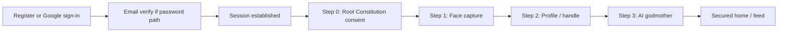

# Onboarding — product assessment

Living **implementation** reference for the signup → activation funnel. Product narrative & feature status: [`PRODUCT_GUIDE.md`](PRODUCT_GUIDE.md). Doc map: [`README.md`](README.md). Also: [`LAUNCH_READINESS.md`](LAUNCH_READINESS.md), [`TRUST_AND_SAFETY.md`](TRUST_AND_SAFETY.md), [`ROOT_CONSTITUTION_PROPOSAL.md`](ROOT_CONSTITUTION_PROPOSAL.md).

**Last reviewed:** 2026-07-24 (async face pipeline; gateway-only Vertex). Prior: 2026-06-29 (step labels 1/4–4/4; Noms signup grant; Panoply + Safety legal card status). Prior: 2026-06-11 council activity; 2026-06-09 post-auth consent. Root charter **v2** — 16 points; consent **`v2-2026-05-29`**. **Content model:** link/text posts; face capture is the **only** transient user image path — see [`PRODUCT_GUIDE.md`](PRODUCT_GUIDE.md) § Content model.

---

## Funnel (canonical order)

Root Operating Charter consent is collected **after authentication** (`/home?onboarding=consent` or inline home-shell panel). Signup and new Google OIDC users start with `users.terms_consent_version = NULL`; `POST /me/terms-consent` records consent once the user attests **16+** and agrees to the charter.

| Step | Surface | Server gate |
|------|---------|-------------|
| Auth | Email/password register + verify, or Google OIDC | `require_verified_session` (email must be verified for password path) |
| 0 | `/home?onboarding=consent` | `human_onboarding::user_has_terms_consent` |
| 1 | `/onboarding` face capture | `user_faces.face_captured_at IS NOT NULL` |
| 2 | `/home?onboarding=profile` | `human_onboarding::user_has_human_profile` |
| 3 | `/onboarding` godmother | Godmother + moderator + `member_of` edges |
| 4 | `/home` feed | Composite `verified` (`src/status/mod.rs`) |

**Activation** unlocks posting, connection rail, feed Noms accrual, and jury eligibility.

**Post-auth routing:** `post_auth::next_path_after_auth` (login JSON `next`, verify-email redirect, OIDC callback) sends users to consent first when `terms_consent_version` is missing or stale.

---

## Shipped step UX (English)

User-visible step labels and copy live in [`locales/en.json`](../locales/en.json). Canonical headings:

| Step | Heading (`en.json` key) | Surface |
|------|-------------------------|---------|
| Signup | `ui.register.heading` (email + password only) | `/login?join=1` |
| 1/4 | `ui.home_profile.terms_heading` — **Before you continue** | `/home?onboarding=consent` |
| 2/4 | `ui.face_capture.heading` — **Human Finder** | `/onboarding` (face card) |
| 3/4 | `ui.home_profile.heading` — **About You** | `/home?onboarding=profile` |
| 4/4 | `ui.face_capture.godmother_heading` — **Choose Your Guide** | `/onboarding` (godmother card) |

**Step 0 — Constitution consent**

- Checkboxes: `ui.register.adult_confirm` (16+) and `ui.register.constitution_confirm` — *I have read and agree to the 256 Root Constitution.*
- Template: [`templates/terms_consent_card_fragment.html`](../templates/terms_consent_card_fragment.html); home-shell loads it when `?onboarding=consent`.
- API: `POST /me/terms-consent` with `constitution_ack: true` → writes `users.terms_consent_version`.
- Guest **Root Constitution** card ([`templates/guest_constitution_card_fragment.html`](../templates/guest_constitution_card_fragment.html)) stays visible on `/login` for reading before signup.

**Google sign-in**

- Branded button on login/register when `OIDC_CLIENT_ID` is configured.
- Existing email/password account → `/auth/oidc/link` password interstitial before linking.
- New Google user → session + consent step (same as password register path).

**Step 1 — Face capture**

- Three-expression capture (neutral / smile / frown); 512×512 pipeline
- **No biometric data is stored.** On-device face detection (detector + landmarks) is only a *face-present* gate — **no face descriptor/embedding** is computed or sent. The server runs vision to describe the face **transiently** (used solely to generate the avatar, then discarded) and stores **only** the generated artwork path + a `user_faces.face_captured_at` completion timestamp. Raw photos are request-only and never persisted. Columns `embedding`, `embedding_dim`, `embedding_model_id`, and `ai_appearance_description` were dropped (migration `20260530140000_user_faces_drop_biometrics.sql`).
- **Capture diversity (expression-agnostic):** after per-image quality checks, the server compares the three transient JPEGs in-request (64×64 grayscale pixel difference) and rejects near-duplicate sets — e.g. the same photo submitted three times. UI prompts for neutral / smile / frown remain UX nudges only; users are not rejected for failing to change expression.
- **Automated submission:** once all three expressions are captured, the client submits automatically — no manual Submit. If the server cannot detect a face (`ui.face_capture.vision_rejected`) or the three shots are too similar (`ui.face_capture.insufficient_diversity`), the user stays on the capture step and can retry; this is the only stall point.
- Success with profile already complete → godmother card on same page; otherwise redirect `/home?onboarding=profile`

**Step 3 — Godmother**

- **2×6 grid** of council options (`static/css/brand.css`, `static/js/face-capture.js`)
- Each card: avatar + councillor first name (left); **community label only** (right) — e.g. *Love & Romantic Relationships* for Aspa; long community **intention** text is not shown
- API: `GET /me/godmother-options` returns `community_label` from `social_community.label` (no intention field)

---

## Consent persistence

Terms acceptance is stored on the user record:

- Column: `users.terms_consent_version` (nullable `VARCHAR(32)`)
- Current version constant: `human_onboarding::CURRENT_TERMS_CONSENT_VERSION` (bump when Root Charter / onboarding copy changes)
- Set via `POST /me/terms-consent` after auth (not at register)
- **Non-null value matching the current version** is sufficient proof of consent

The consent step UI shows the **Root Operating Charter** from `locales/en.json` (`ui.login.constitution_item_*` through `_16`), aligned with [`ROOT_CONSTITUTION_PROPOSAL.md`](ROOT_CONSTITUTION_PROPOSAL.md). **v2 (16 points) shipped 2026-05-29.** Current consent version: **`v2-2026-05-29`**.

**Re-consent:** users with an outdated `terms_consent_version` are routed to the consent step on login (`post_auth::next_path_after_auth`).

---

## AI Council — godmother & ongoing council activity

**Godmother (shipped):** Step 3 wires godmother → moderator → `member_of` on the user's chosen steward community. The unified `godmother_outreach` job posts private `@private` messages for **welcome** (on select), **global failing** (after owner failing email), and **global recovery** (lifecycle flush when rating returns ≥ 0.66) — LLM copy in the councillor's AVC voice with locale fallback if AI unavailable.

**Ongoing participatory activity (shipped):** councillors autonomously reply, share portfolio links, and (during rollout) route platform invites — budgets, steward voice, and job cadence in [`PRODUCT_GUIDE.md` § AI Council](PRODUCT_GUIDE.md#ai-council). Requires `ai_gateway` + migrations through `20260611160000_council_cross_community_membership.sql`.

---

## Business risks & mitigations

### 1. Email verify + re-login friction

**Today:** `/verify-email?token=…` verifies email, creates a session via [`session::start_user_session`](../src/auth/session.rs), sets the `sid` cookie, and redirects via `post_auth::next_path_after_auth` (consent first if needed). Invalid or expired tokens still land on `/login?verify_error=1` without a session.

### 2. Consent persistence

**Today (2026-06-09):** Post-auth consent via `POST /me/terms-consent`; signup/OIDC leave `terms_consent_version` NULL until completed. Prevents OIDC from bypassing charter acceptance.

### 3. Step order vs marketing copy

**Today:** Implementation and docs agree — **auth → consent → face → profile → godmother**.

### 4. Face capture friction

High-friction step (camera, models, `ai_gateway`). **Live on beta** (2026-06-29; **async pipeline + Epic illustration** 2026-07-24). **Accepted product cost:** age-verification and human-proof requirements for social platforms are tightening industry-wide; a live face-present check is the price of running a credible human-only social graph. **No biometric template is stored** (litigation-risk decision): face detection runs on-device only as a liveness gate; capture JPEGs are transient (async job staging, then deleted); only the generated avatar + `face_captured_at` persist — never embeddings or appearance text in DB. Flow: `POST /me/face-capture` (202) → poll status → `face_portrait_pipeline` (validate → colour card → Imagen). Onboarding portraiture remains **Nom-waived**; see [`BETA_AI_SETUP.md`](BETA_AI_SETUP.md) and [`PRODUCT_GUIDE.md`](PRODUCT_GUIDE.md) § Onboarding portrait pipeline.

### 5. SMTP / pre-production environment

**Today:** Local laptop development; verification links log at INFO when `SMTP_*` is unset.

**Plan:** **`pre.256.app`** pre-prod domain when deployment pipelines are set up — registered domain, HTTPS, SMTP, Google Maps, AdSense testing. Not blocking current local development.

### 6. Age rule

**Today:** **16+** everywhere that matters — consent step (`ui.register.adult_confirm`), profile DOB validation (`MIN_AGE_YEARS = 16` in `human_onboarding.rs`), and auth error copy. No 18+ divergence in product copy.

### 7. Rating & constitution explainability

**Deferred to godmother AI** (see table above). Humans enter at **2.50** rating at profile creation; godmother onboarding message should cover standing, failing band, login refund of inactivity debits, and community constitution basics.

### 8. Trust & safety — onboarding prerequisites (partial — Root charter v2 shipped 2026-05-29)

Public launch requires Tier 1–2 safety **before** open signup. Full build list: [`TRUST_AND_SAFETY.md`](TRUST_AND_SAFETY.md) §P0.

| P0 item | Status | Onboarding touchpoint |
|---------|--------|------------------------|
| Emergency + civic filing | **Live** | Filing at `/home/judicial/post/{post_id}` — §4.1–§4.7 emergency vs other clauses |
| Acute harm sanitation (point 15) | **Partial (shipped 2026-05-29)** | Charter text + audit log + face-capture hash stub; vendor API backlog |
| Mandatory reporting (point 16) | **Partial** | Charter text in consent UI; hotline automation ops backlog |
| Post-card civic dispute shortcut | Not built | Non-acute disputes when shipped |
| Operator emergency takedown | **Live** | `/home/ops` Panoply console — [`PRODUCT_GUIDE.md`](PRODUCT_GUIDE.md) § Panoply operator console |
| Published safety policy | **Live (legal card)** | `/safety` → Safety & Crisis card (`ui.legal.safety_body` + crisis hotline panel); expanded standalone policy page deferred |
| Human graph block / mute | **Live** | Full signed-in mute — see [`PRODUCT_GUIDE.md`](PRODUCT_GUIDE.md) § Human block list |
| Closed-beta operator on-call | Process | Document for invite-only beta |
| Auth abuse controls | **Live (2026-06-09)** | reCAPTCHA v3 + rate limits on register/login/OIDC — see [`PRODUCT_GUIDE.md`](PRODUCT_GUIDE.md) § Authentication |

Onboarding surfaces the **shipped v2** Root Charter (16 points) via `root_constitution_content_fragment.html` — aligned with DB `operating_charter_256` and consent **`v2-2026-05-29`**. Safety & Crisis copy is reachable via `/safety` (guest legal card) and filing surfaces — see [`PRODUCT_GUIDE.md`](PRODUCT_GUIDE.md) § Feature inventory.

---

## Monetization at activation

- Noms wallet credited **`SIGNUP_NOM_GRANT` = 32** on human profile creation (`src/social/noms/mod.rs`; ledger `CreditSignup`)
- Ongoing accrual: **+1 Nom** on first login each UTC day; **+3 Noms** when you complete jury duty (case resolved). **Ad-free** feed — no ad accrual
- Onboarding face capture: free (`PortraitureBilling::OnboardingWaived`)
- Avatar redraw post-onboarding: 16 Noms — **re-captures fresh photos** each time (vision runs transiently; no stored appearance is reused) and keeps an explicit confirm button before charging

---

## Key source files

| Concern | Path |
|---------|------|
| Composite verification | `src/status/mod.rs` |
| Terms consent version | `src/social/human_onboarding.rs` (constant); `POST /me/terms-consent` in `src/routes/social.rs` |
| Post-auth routing | `src/auth/post_auth.rs` |
| Onboarding pages / redirects | `src/routes/home.rs` |
| Face / godmother APIs | `src/routes/social.rs` |
| Async face pipeline | `src/social/face_capture_pending.rs`, `src/social/face_capture_validate.rs`, `src/social/face_capture_canonical.rs` |
| Onboarding funnel gate | `src/auth/onboarding_gate.rs`, `src/auth/post_auth.rs` |
| Verify-email auto-login | `src/auth/verification.rs`, `src/routes/health.rs` |
| Google OIDC | `src/auth/oidc/`, `src/routes/auth_oidc.rs` |
| reCAPTCHA | `src/auth/recaptcha.rs`, `src/auth/captcha_gate.rs` |
| Consent UI | `templates/terms_consent_card_fragment.html`, `static/js/home-shell.js` |
| Signup UI | `templates/register_card_fragment.html`, `templates/login.html` |
| Constitution / charter content | `templates/guest_constitution_card_fragment.html`, `templates/root_constitution_content_fragment.html`, `src/ui/fragments.rs` |
| Face capture page | `templates/face_capture.html`, `static/js/face-capture.js` |
| Godmother grid UX | `static/css/brand.css` |

---

## Changelog

| Date | Change |
|------|--------|
| 2026-08-11 | Async face capture — colour card + multi-sample likeness pick; style plate v6; face-mesh generation removed |
| 2026-06-29 | Step labels synced to UI (1/4–4/4); Noms signup grant 16; Panoply + Safety legal card marked live in T&S table |
| 2026-06-11 | Council participatory activity shipped — godmother welcome + reply/share/invite batch jobs; steward-voice prompts; cross-community `member_of` (see PRODUCT_GUIDE § AI Council) |
| 2026-06-09 | Post-auth consent (OIDC-safe); Google OIDC + reCAPTCHA; funnel step 0; MIN_AGE doc fix (16+) |
| 2026-05-30 | Root Constitution consent moved to the signup card — **superseded 2026-06-09** by post-auth consent |
| 2026-05-25 | Initial doc; consent column; charter on terms card; godmother 2×6 grid; face submit loader; AI council activity plan → moved to PRODUCT_GUIDE |
| 2026-05-29 | Root charter v2 shipped (16 points); consent `v2-2026-05-29`; T&S table updated |
| 2026-05-28 | v2 charter proposed (16 points); onboarding T&S table updated |
| 2026-05-25 | Doc sync: step 1/4–4/4 copy, consent checkbox/button, face submit wait message, godmother compact labels (no intention) |
